# sysjam

A jam band of machine musicians playing your Linux system. Six autonomous
players (drone, bassist, drummer, keys, lead, colour/FX) listen to CPU,
cores, network, disk writes, file activity and screen colour, and to each other.
A loose bandleader moves the arrangement through **chilling → awakening →
alive → subsiding** on its own musical drive, so **an idle machine sounds just as full**: load,
typing and the rest only push the band higher and faster and colour its sound choices. Every run
starts in a random key (any of the 12 roots, major or minor) at a random tempo
(60–100 bpm). The tempo then breathes with the arrangement and the key wanders
around the circle of fifths. Players pick up a new General MIDI instrument or
design a new synth patch whenever something inspires them. Under everything sits
a continuous deep sub drone and bass. No two runs are the same unless you pass `--seed`.

You can steer it from the terminal UI. **↑/↓** nudge the tempo; **←/→** change the conductor's
**style**: House Band, Ambient Monk, Jazz Cat, Blues, Country, Biker, Metal, Industrial, Baroque,
Celtic Session, Techno, Space Cadet, Tribal/Gamelan, or *auto* (the default: it wanders between them).
Each style changes the band's instruments, tempo, drum feel, harmony, bass line and theme quotes,
and it restyles the whole UI (palette, borders, icons, meters, and the conductor's outfit and voice).
See [Steering](#steering-tempo-and-conductor-styles). A switch you ask for is a hard cut: the old
style stops at once, a one-beat pickup in the new style follows on the next beat, then the band.

Everyone on stage is a little animated character. The conductor beats real conducting patterns
phase-locked to the audio you are hearing, and each musician moves with their own notes (sticks on
the drum hits, plucks, bowing, a horn that tilts up for high notes, a drone that breathes). The
conductor also has **feelings** (16 blended moods) worked out by a tiny on-device neural net, and
he learns what you like, but **only** when you press **`l`** (like). See
[the conductor's feelings](#the-conductors-feelings-and-his-tiny-brain) and [likes](#likes-the-only-thing-sysjam-learns-from).

| Country | Techno |
|---|---|
| 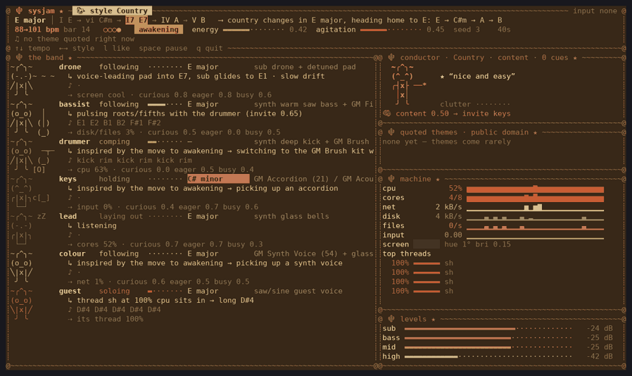 | 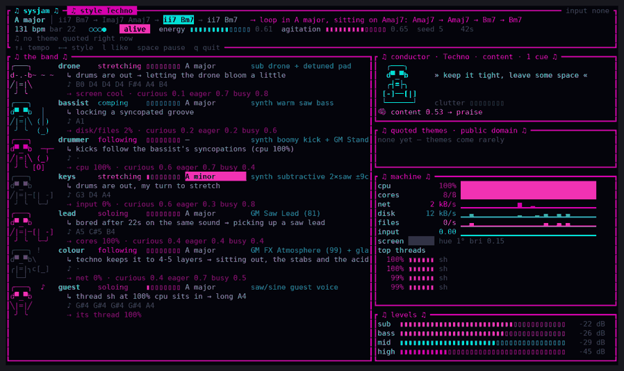 |

(Formerly developed under the working name *sysmusic*.) Listen: [`docs/sample.mp3`](docs/sample.mp3) is a 75 s demo at 192 kbps. It starts calm with no hiss, then hits chaos (CPU + network + disk load plus simulated fast typing), where a short burst of industrial noise comes in, then settles again. Its verbose log is `docs/sample-render.log`. [`docs/sample-tempo.mp3`](docs/sample-tempo.mp3) is a 90 s demo (seed 5, made with `tools/demo_tempo.sh`). It starts in A major at 84 bpm, and the tempo eases down to 73 while the band is chilling. Under load (from 18 s) the band comes alive and ramps toward 97 bpm. At about 60 s a **surge** opens the throttle from 85 to 133 bpm with the V-twin lope, while the band modulates to D minor. The surge winds down to 109 bpm at about 75 s, and the band then subsides. Its log is `docs/sample-tempo-render.log`.

[`docs/sample-idle.mp3`](docs/sample-idle.mp3) is 60 s of an **idle machine** (House Band, seed 1,
no load and no input at all; offline idle profile from 25 s): the drummer joins at 0.4 s, the band
goes alive at 12.1 s, and its own surge (the V-twin lope) comes at 51.1 s; −13.7 LUFS.

Per-style samples (offline renders, GM TimGM6mb):
[`docs/sample-industrial.mp3`](docs/sample-industrial.mp3) (60 s: a menacing verse, a build, the
wall-of-sound chorus, a one-kick breakdown, the next build and chorus; −12.6 LUFS, peaks −0.8 dBFS),
[`docs/sample-biker.mp3`](docs/sample-biker.mp3) (60 s: a galloping verse, the pre-chorus, the
chorus hook with the gang vocals and choir, a twin-guitar solo, the chorus again; −11.8 LUFS) and
[`docs/sample-blues.mp3`](docs/sample-blues.mp3) (30 s: the end of a 12-bar shuffle chorus with the
harp's calls and the guitar's answers, the turnaround, then a harmonica solo chorus, conductor:
"take it, harp!", from 8.2 s; −15.2 LUFS, peaks −2.0 dBFS).

The three newest styles, each 60 s of an **idle machine** (seed 1, offline idle profile, no load
and no input): [`docs/sample-metal.mp3`](docs/sample-metal.mp3) (from 10 s of the run: the end of a
thrash verse, a **blast beat** that pushes the tempo up, thrash again, a half-time **breakdown**
with gang chants, then a **shred solo** with twin leads; −12.8 LUFS, peaks −1.2 dBFS),
[`docs/sample-country.mp3`](docs/sample-country.mp3) (from 38 s: the end of a train-beat verse, a
call-and-response **chorus** (fiddle/harmonica call, Telecaster answer), a **chicken-pickin'
Telecaster** break, the next verse; −15.3 LUFS, peaks −1.0 dBFS) and
[`docs/sample-celtic.mp3`](docs/sample-celtic.mp3) (from 20 s: the B part of the jig *Planxty
Scott*, then the set moves on to the reel *Belles of Tipperary*, 6 bpm faster, and its A and B
parts; −13.4 LUFS, peaks −1.5 dBFS). Above 12 kHz they sit at −40 / −40 / −53 dB of the total.


One static-ish binary (`sysjam`, ~2.2 MB, x86_64, needs glibc ≥ 2.29). It
links only libc, libm, libpthread and libdl. ALSA, D-Bus and PipeWire are
loaded at run time with `dlopen`, so it starts even when one of them is missing.

## Run

```bash
./sysjam                         # play with the live terminal UI (q fades out; twice = quit now)
./sysjam --no-tui                # plain log output instead of the UI
./sysjam --no-tui --verbose      # plain log of everything: chords, players, instruments, metrics
./sysjam --volume 0.4 --sub 1.5  # quieter overall, more sub
./sysjam --seed 42               # reproducible run
./sysjam --wav out.wav --duration 120   # render to a file (real time)
```

| Option | Meaning |
|---|---|
| `--volume V` | master 0–1 (default 0.6) |
| `--sub L` | sub-drone level 0–2 (default 1.2). The sub is never high-passed; a gentle limiter guards the output |
| `--scale minor\|major`, `--root NOTE` | home key. Default: random each run (all 12 roots, major or minor, root in D#2–D3). Given flags are used exactly. Older scale names still work: dorian etc. map to minor, lydian etc. to major |
| `--bpm N` | lock the tempo at N. Default: a random start of 60–100 bpm, after which the bandleader moves it |
| `--style NAME` | conductor style: `auto` (default), `house`, `monk`, `jazz`, `blues`, `country`, `biker`, `baroque`, `celtic`, `industrial`, `techno`, `space`, `tribal` (names and unique prefixes work). ←/→ in the TUI |
| `--tempo-bias N` | sticky bpm offset on the living tempo (±70, the tempo stays within 50–160). ↑/↓ in the TUI nudge it by 7 |
| `--reset-likes` | forget everything you liked (deletes `~/.config/sysjam/likes.yaml`) and start fresh |
| `--ascii` | plain ASCII TUI: no emoji, box drawing or symbols. Automatic on `TERM=linux` |
| `--chord-bars N` | base bars per chord (default 2). Chilling stretches this, peaks tighten it |
| `--seed N` | repeat a run exactly (same input → same music) |
| `--soundfont PATH`, `--no-gm`, `--gm-layers N` | General MIDI layer (see below); N = 1–4 simultaneous layers (default 3, +1 at peaks) |
| `--clicks L` | file open/close click texture 0–1 (default 0.25) |
| `--no-leads` | no guest musician (neither a busy program nor the band's own featured guest) |
| `--no-input` | don't watch keyboard/mouse activity (see below) |
| `--no-audience` | no process crowd under the band, and no audience scan at all (see [the audience](#the-audience-your-processes-on-the-dance-floor)) |
| `--no-screen`, `--screen-method auto\|portal\|grim\|x11\|cmd`, `--screen-cmd CMD`, `--screen-interval S` | screen colour (see below) |
| `--device NAME` | ALSA device (`default`, `pipewire`, `pulse`, `hw:0`) |
| `--no-tui` | plain log lines instead of the live terminal UI (the UI is the default when stdout is a terminal) |
| `--null`, `--duration S`, `--verbose` | testing / logging (`--verbose` adds metrics lines with `--no-tui`) |

## Live terminal UI

When stdout is a terminal, sysjam opens a full-screen terminal UI (ratatui +
crossterm) that shows how the band is thinking. Piped or redirected output, or
`--no-tui`, gives the plain log instead.

- **Header**: key, the chord progression with roman numerals (past chords dim,
  the current chord highlighted, the planned ones after it), the home key when the
  band is away from it, e.g. `D minor (home A major)`, the tempo with an arrow while it is
  ramping (`105→98 bpm`; `(locked)` with `--bpm`), any half-time, double-time or `surge — V-twin lope` feel, bar and beat,
  the arrangement state (chilling / awakening / alive / subsiding) and the
  bandleader's energy and agitation meters, and `tempo bias +14` while you have nudged the tempo.
  The top border carries the style badge (`🐎 style Country`, `♪ style auto · Blues`, or
  `♪ style Blues ← Country, changing over…` during a switch). Top right: the input source
  (`evdev×2`, `evdev×2 setgid`, `usb-hid`, `irq i8042`, `irq xhci≈`, `none`) with one combined activity meter.
  The bottom border shows the key hint `↑↓ tempo  ←→ style  l like  space pause  q quit`.
  After you press `l` a `♥ liked (n)` badge flashes in the top border.
  The first line also shows where the harmony is heading, e.g.
  `⟶ heading to D minor: Dm (pivot) → Bbmaj7 → A7 → Dm7` or `⟶ callback to the phrase from 6 phrases ago: …`.
  The third line is the persistent **`♫ now quoting`** line: while a player quotes a
  theme it shows a progress meter, the player and the full citation, e.g.
  `♫ now quoting ██▍ lead: Wachet auf, ruft uns die Stimme (J.S. Bach, BWV 140.7) · music21 corpus (Bach chorales) · public domain — a straight quote`.
- **The band**: one panel per member: drone, bassist, drummer, keys, lead,
  colour/FX, plus the featured guest when one sits in. On the left of each panel is the
  member as a small animated character (10 columns × 4 rows, 3 on short terminals), driven by the
  notes the engine actually plays, at the moment you hear them:
  - **drummer**: the sticks come down on each hit (alternating hands), the snare flashes, the kick
    drum thumps, and the cymbal wobbles after a hat, ride or crash;
  - **bassist**: an upright that bobs the player's head and shows the pluck;
  - **keys**: piano (a key goes down), organ (two manuals, alternate hands) or electric piano poses,
    by the GM program;
  - **lead / colour**: guitar strums, a bowed fiddle (long down-bow, short up-bow), brass that
    tilts up on high notes (with a bend squiggle in Blues), a sax with notes floating up, a flute
    with moving fingers, mallets on bells, knobs turning on a synth; leads sway on the beat;
  - **drone**: eyes closed, breathing every two beats, humming `~ ~ ~`;
  - **guest**: walks on from the right holding the style's guest instrument (a sax, a fiddle, a
    mic, a flute…) when one sits in, captioned with who and on what (`firefox·fiddle`), and walks off again;
  - **resting** players put the instrument down: coffee (`c[_]`), dozing (`zZ`) or a phone (`[:]`);
    a **hushed** player looks sheepish (`(._.)` and `shh`); an **instrument swap** slides the old
    instrument out and the new one in; a player quoting a theme gets a `(♫)` bubble;
  - they glance at the conductor: a sweat drop when he's cross, a sparkle when he beams;
  - everyone wears the style's costume: cowboy hats in Country, sunglasses in Blues, headphones in
    Techno (glowsticks while resting), wigs in Baroque, hard hats in Industrial, helmets in Space Cadet.

  Each panel then shows:
  - the member's status: laying out, holding, comping, following, soloing, trading, grooving (drums),
    stretching (a synth voice coming forward while the drums are out) or quoting;
  - an activity meter and the current GM instrument or synth patch;
  - a "thinking" line explaining the latest decision, e.g. `heard a network burst (98%) → adding shimmer`,
    `resolving the motif to the root (A4), then resting`,
    `kicks follow the bassist's syncopations`, or
    `thread make at 100% cpu sits in → long E5`, or why it picked up a new sound,
    e.g. `inspired by the modulation to D minor → picking up a fifths lead`;
  - the notes it played in the last few seconds, plus the machine signal it is tied
    to (`⇢ net 98%`) and its personality (`curious 0.4 eager 0.5 busy 0.6`).
- **Conductor** (top right; he lives only in this panel): a figure that **conducts in time**.
  The panel takes all the spare height of the right-hand column (the other panels are sized
  to their content), and he grows with it: the 5-row figure on small terminals, a **9-row
  expressive conductor** (12 rows with longer legs) when there is room, and an **extra-large
  18-row** one (every cell drawn 2 × 2) on tall, wide terminals. The big one has brows, eyes
  and a mouth that moves while he talks, a free hand that points, shushes, pumps a fist,
  face-palms, waves, rests on his heart or his hip, checks his watch, bites his nails or
  slaps his knee laughing, and footwork (weight shifts, toe taps, kicks, stomps, tiptoes,
  crossed legs, jittery knees, a stool when he rests), all picked from his mood. His
  runner-up feeling shows on alternate bars, and beside him a bar chart of the brain's
  strongest feelings, valence / arousal and his recent cues fill the panel. Its baton traces real
  conducting patterns, phase-locked to the beat you are hearing (see
  [In time with the audio](#in-time-with-the-audio)):
  - 4/4: down, left, right, up, with the downbeat (the lowest point) exactly on beat 1;
  - half time: a 2-beat down-up over the whole bar; double time: the 4-pattern twice per bar;
  - Blues' 12/8 shuffle: a little tick on the swung third triplet of every beat;
  - 3/4 (triangle) and 2/4 (down-up) patterns are built in too; all current styles play in 4/4;
  - tempo ramps and surges are followed continuously, because the baton position is computed from the
    engine's beat clock rather than from a frame counter;
  - the gesture grows and shrinks with his mood's energy.

  Other poses: sitting on a stool (`zZ`) while the band is chilling, `shh` with a finger to his
  lips when he hushes someone, pointing (`────>`) when he cues or invites a player, both arms
  up during a surge. In Techno he is a DJ: the platters spin with the beat and his hands go up on
  every kick. His face shows his **mood** (`(^_^)` content, `(^o^)*` delighted, `(>_<)#`
  frustrated, `(-.-) zZ` sleepy, `(O_O)'` anxious, `(;_;)` melancholy…), the panel title shows the
  mood name, and the bottom line shows what his little brain is thinking, e.g.
  `🧠 frustrated 0.62 → hush keys` (mood, its weight, the intervention or speech intent it leans to).

  Its speech line shows the current instruction, e.g. `“keys, bring it down”`, or how he feels,
  in the style's voice (`“Hot dang! y'all, that's the sound”`, `“that's not a wrong note, that's a choice”`).
  The addressed player's panel lights up yellow for a few seconds, and its thinking line shows the
  exchange: `conductor: keys, bring it down → “ok, quieter”`. The panel title counts the
  interventions so far.

  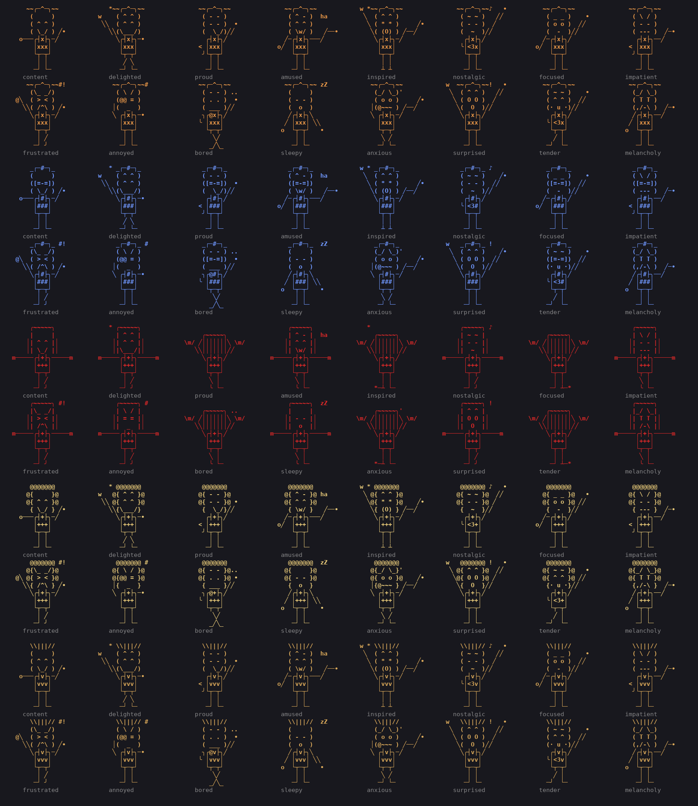
- **Quoted themes** (right, under the conductor): a scrolling history of the recent
  citations with their time, newest highlighted.
- **Machine**: CPU, busy cores, network, disk writes, file churn and input
  activity (keyboard and mouse combined), each with a sparkline of the last two minutes. Below them sit a
  swatch of the sampled screen colour and the busiest threads.
- **Levels**: sub (< 60 Hz), bass, mid and high meters of the output.
- **Band events**: a rate-limited log of instrument changes, band moves,
  modulations, guests, and the conductor's instructions with the players' replies.

Keys:

| key | action |
|---|---|
| `↑` / `↓` | tempo bias ±7 bpm, ramped over one bar (hold to repeat, ~6 per second) |
| `←` / `→` | previous / next conductor style (auto → House Band → … → Tribal → auto) |
| `q`, `Esc`, `Ctrl-C` | fade out and quit (press again to quit immediately) |
| `n` or `Tab` | **next idea**: move on right now, within about a beat (see [next idea](#next-idea-and-never-dead-air)) |
| `l` or `Enter` | **like** what's playing now (see [likes](#likes-the-only-thing-sysjam-learns-from)) |
| `a` | force the crowd panel on / off (by default it shows by itself when the terminal is at least 160×55) |
| `space` | pause / resume the display (the music keeps playing) |

The footer shows them: `↑↓ tempo  ←→ style  n next  l like  a crowd  space pause  q quit`.
The arrow keys only work in the TUI; `--style` and `--tempo-bias` are the command-line equivalents.

The UI runs in its own thread at nice 5. The audio thread publishes a small snapshot about every
100 ms with a non-blocking `try_lock`, so a slow or stalled terminal can never hold up the audio.
The whole UI refreshes about twice a second (once a second on a very big terminal); in between, only the little people (and the beat
dots) are redrawn, at about 16 fps, straight to the changed cells, plus one extra frame exactly on
every beat. The stage and the crowd move at about 7–8 fps (and on every beat) and are diffed cell by
cell against what is already on screen, so only the cells that actually changed are sent (about
1,150–1,350 cells a second with the stage, lights and crowd on). The big background washes of the
stage lights change bar by bar; the lamps and beam edges pulse on the beat. Frames where nothing
moved are skipped, and only colour changes are sent to the terminal. That keeps the UI thread at
about 0.42–0.47% of one core with the stage and the crowd on (measured below).

All figures are drawn only from ASCII, light box drawing (`─│┌┐└┘├┤┬┴┼╭╮╯╰╱╲`) and `♪ ♫ • ·`:
no block or shade elements (hats are drawn with box lines, e.g. the cowboy hat `~╭^╮~`), no heavy/light mixing, no rare
IPA letters, no emoji, no combining characters or variation selectors. Every frame of every pose,
mood, style and instrument is checked by a unit test to be exactly 12 (conductor) or 10
(musician) cells wide by `unicode-width`, so nothing shears in any terminal font. (The old Tribal
figure's `╿╽` headdress, `ᴗ` mouth and `▒` robe are gone: it now wears `\|||/`.)

### The stage

When the band panel has room (at least 64 × 18 cells inside; the 170 × 56 layout has plenty) the
band plays **on a stage** instead of the list:

- **A lighting truss** with lamps whose beams fan out over the players: the beam edges are drawn
  with `╱ ╲` and the inside is a translucent wash (the light's colour blended into the
  background, truecolor or the nearest 256-colour step). They pulse on the beat, all flash on the
  downbeat and change colour with the section. The mood picks the rig: a red strobe on the 16ths
  in Industrial's wall of sound and builds, steady warm amber in Jazz, Blues, Country and Baroque,
  the theme's six accents cycling elsewhere. Amp stacks stand at the edges (with `##` grilles in
  Industrial).
- **Each player with their instrument as a prop**, picked from the GM program or synth behind
  them: a grand piano with its lid up (programs 0–2), an upright/honky-tonk (3, 6), stage keys, an
  organ with pipes and drawbars, a drum kit (taiko for Ambient Monk, timpani for Baroque, a metal
  rig of pipes, sheet metal and drums for Industrial), a double bass or cello with its bow, a
  bass guitar, a harp, a tuba/sousaphone, guitar, banjo, fiddle, sax, trumpet/brass, flute,
  harmonica, accordion, bagpipes, sitar, koto, kalimba, steel drums, marimba/vibes, tubular bells,
  a gong, a synth rig with a patch wall, a modular for the drone, DJ decks in Techno and a
  vocalist's mic (the Biker frontman). Big instruments get wide slots; when the stage is tight
  the amps go first, then synth rigs and then the others fall back to the small figures, the
  drums last. **Every move comes from the notes the player actually sounds**, read from the
  heard-note clock (each note is logged with the sample at which it reaches the speakers). The
  drummer has a limb per voice: right stick on the hi-hat (`==` closed, `~~` open), left stick on
  the snare, right foot on the kick, left foot on the hat pedal, both sticks sweeping the toms in
  a fill, an arm up for a crash or ride; the sticks stay still between hits. Guitars, banjo and
  bass strum or pluck per note with the picking hand alternating, the fret hand moves along the
  neck with the pitch, and Metal gets palm-muted chugs (`_=`). Keyboards press the key under the
  pitch: the left hand for low notes, the right for high, both for chords. Horns, voice and
  harmonica open the mouth and puff the cheeks while sounding and breathe between phrases; bows
  change direction on each note and mallets strike. Silence is a relaxed pose. The UI puts a
  frame on each note as it sounds (at most ~30 a second, otherwise ~15 fps), so a hit is on
  screen a median 1.5 ms and at worst 35 ms after it is heard, inside one 66 ms frame (measured
  with `SYSJAM_HITLOG=path`, which logs each note's sound-to-screen offset). A new instrument is
  carried off to the right and the new one wheeled on (1 s). A soloist steps forward a row.
- **One-line captions** (`keys·grand·E`, the addressed player highlighted), the **stage lip**,
  and a slim apron with the frontman's yells in a bubble and wedge monitors (the conductor
  has his own panel, so the stage gives those rows back to the band and the crowd).
- Under the stage, **one condensed "thinking" line per player** (`bassist ↳ locked to the kick`).
- Small terminals keep the old list view with the little figures. `SYSJAM_STAGE=0` forces it.

All prop art is static text built once (two frames per prop, patched per limb from the notes), only from the same width-safe glyph
set as the figures; a unit test checks every frame for width and glyphs and that it has exactly
one face (also for every note-driven pose). The stage is redrawn in the in-between frames like the figures and crowd, and only the
runs of cells that changed are written.

### In time with the audio

The audio thread stamps every 16th-note step into a lock-free ring of atomics (step number, the
engine sample it starts on, its length, and the feel: half/double time, surge, shuffle), and every
note a player plays into a per-player hit ring (sample, pitch, velocity). After each block it
writes to the sound card it records how far ahead of the speaker it is (ALSA `snd_pcm_delay`), so
the UI can tell which engine sample is being **heard** right now. Each frame asks "which sample is
in the air?" and draws the baton and the musicians for exactly that point in the music. The UI
also wakes up exactly on each beat, so the downbeat frame isn't left to a 66 ms frame grid.

Measured (Techno, seed 5, 75 s in tmux, 3 tempo nudges up and 5 down during the run): the engine's
154 synth kicks were found in the rendered audio a median 0.9 ms after their scheduled sample. The
first frame of each beat reached the terminal a median **−0.7 ms** from the heard kick (mean −1.1,
95% within ±11 ms, worst 43 ms), well within one frame (61 ms at 16.3 fps).
 The terminal is restored
on exit and also when sysjam panics. Colours follow `NO_COLOR` (crossterm drops all
colour codes). Theme colours are truecolor when `COLORTERM` is `truecolor`/`24bit`, otherwise
they are mapped to the nearest xterm-256 entry. `--ascii` (automatic on the Linux console)
transliterates every glyph to ASCII. The UI needs a terminal of about 100×30 or larger; 130×36 is comfortable.

## Steering: tempo and conductor styles

**Tempo (↑/↓).** Each press adds ±7 bpm of *user bias* on top of the living tempo, and the
band ramps there smoothly over one bar. The conductor acknowledges it in its style's voice
(`“picking it up!”`, `“giddy-up!”`, `“more BPM!”`) and the drummer's thinking line shows the new
target. The bandleader keeps moving the tempo with the arrangement; the bias rides on top, and the
result is clamped to 50–160 bpm. Key-press bias **holds for a minute after the last press, then
fades** with a ~90 s half-life (gone after about 5 minutes), so the band drifts back to its own
feel. `--tempo-bias N` is **sticky** (it never fades). With `--bpm` the locked tempo plus the bias
is used.

**Styles (←/→).** A style is a conductor personality. It changes the instruments (inspired swaps
favour the style's GM programs and synth patch kinds), the tempo range, density and strictness,
the drum kit and feel, the bass line, harmony templates, modes, synth vs GM preference, and which
theme collections get quoted. The core rules hold in every style. The deep sub and bass are always
there. There is no hiss except Industrial's deliberate gated texture. The synth sits back while the
drums play (Space Cadet and Techno loosen this). Restraint and CPU stay as before.

| style | one line |
|---|---|
| **auto** (default) | starts as House Band and wanders to another style every 5–9 minutes, at a phrase boundary |
| **House Band** | the balanced default: a bit of everything, nothing pushed |
| **Ambient Monk** | 50–84 bpm drones, sparse, strict hush, Lydian/major drone harmony, pads and choirs, almost no drums |
| **Jazz Cat** | swing, ii–V–I and turnarounds with sevenths everywhere, walking upright bass, brushes and ride, EP/vibes/sax, more quotes, a loose conductor |
| **Blues** | its own band (`src/blues.rs`): a swinging 12-bar shuffle in a major/dominant key (I7–IV7–V7, quick change now and then, a turnaround with a tom-triplet fill) at 80–120 bpm. **Every player swings the same triplet grid** (the "and" lands 2/3 through the beat, 2:1): ride/hat shuffle with the backbeat snare accented on 2 and 4 and the kick pushing into 3 and into the next bar, a boogie-woogie walking bass 1-3-5-6-b7-6-5-3 in swung 8ths, piano stabs (3-b7-9 shells) on the "and"s with anticipations of the next chord and a boogie left hand, the guitar's 5-6 shuffle chug, a warm GM organ bed, harmonica calls with bends and wails answered by guitar licks. Melody comes **only from blues scales** (minor blues 1 b3 4 b5 5 b7, major blues 1 2 b3 3 5 6, Mixolydian over the V7); no per-player keys, no modal drift, no minor dirges. The "synth seat" plays **featured solos** instead: 1–3 choruses of harmonica first, then guitar, tenor sax, a piano break or slide guitar, with AAB phrasing (a riff, the riff again over the IV, an answer), climbing register and heat each chorus while the band backs off; the conductor cues it ("take it, harp!", "Lord have mercy!") and the soloist steps forward on the stage. Synth: only a faint pad bed and a quiet sine under the bass |
| **Country** | its own band (a mode of the session machine, `src/country.rs`): I–IV–V in major with a Mixolydian bVII now and then, 80–120 bpm, in **verses**, a **call-and-response chorus** and **instrumental breaks**. Three feels chosen verse by verse: the **train beat** (snare sixteenths accented on the "and"s and 2 & 4, kick on 1 and 3, cowbell when it's rolling), the **two-step** (cross-stick on 2 and 4, 8th hats) and a **shuffle** (swung 8ths, 2:1). **Boom-chick bass**: the root on 1, the fifth on 3 (alternating), quarter-note root–fifth in the two-step, walk-ups into the changes, a deep sine under it. **Chicken-pickin' Telecaster**: staccato lines with muted clucks, double stops on the beat and B-bender pre-bends, plus a cluck on 2 and 4; **pedal steel** sliding up a semitone into a 3rd + 5th (or 6th + root) on each chord, with a slow slide down at the end of a phrase; **fiddle** or **harmonica** fills between the lines (bar 4 of each half; the Tele takes the other); honky-tonk piano on the backbeat with b3→3 grace slides and runs. The chorus: the fiddle or harp calls for two bars, the Tele answers, the call again, the answer resolves. Breaks rotate Tele, fiddle, steel, harmonica. **No synth at all** (harmonica, piano and cowbell instead) |
| **Biker** | hard rock at 110–160 bpm with a song form: verse → pre-chorus → CHORUS with a recurring hook (the same motif and progression come back, e.g. i–bVI–bVII–i or I–bVII–IV), and twin-guitar solos. Maiden gallops (8th + two 16ths) on two GM distortion/overdrive guitars, synth chugs and the bass, double-kick gallops; big kick, snare on 2 and 4, crashes, tom fills; open ringing chords in the chorus; twin leads in thirds, pinch squeals and bends; formant-synthesized vocals (shouts, growls, "yeah!", gang "whoa-oh") plus GM Choir Aahs/Voice Oohs in the chorus. The V-twin lope surges still come (from a verse). E or A, minor or Mixolydian |
| **Metal** | the rage machine's third band (`src/metal.rs`), between Biker and Industrial on the ←/→ ring: **down-tuned** (E, D or C♯ minor; the bass at 35–65 Hz, the chugs an octave up) **palm-muted chugs** with open power-chord accents on two GM distortion guitars plus a synthesized chug and a distorted bass + sub locked to the kick; riffs in **Phrygian**, **harmonic minor** (Phrygian dominant) or **diminished** colours (i–bII, i–bv, #vii°–V) that change from song to song. A song form with tempo surges: **thrash** verses (double kick locked to the riff, snare on 2 and 4), **blast beats** (kick on every 16th, snare on the off-8ths, tremolo-picked riff) that **push the tempo up 14–24 bpm**, **half-time breakdowns** (snare on 3, syncopated open-string chugs with the kick doubling every one, china on the quarters, gang chants "HEY!") that bring it back down, and **shred solos**: four-note sequences up and down harmonic minor in 16ths with a bent top note, then **harmonized twin leads** in thirds. Formant-synthesized **growls** and **screams**, gang chants on the choir. Synth nearly absent: only a dark pad from the colour seat under the breakdowns |
| **Baroque** | chorale cadences and Pachelbel-ish progressions, harpsichord, strings, church organ, contrabass, Bach/Handel/Mozart/Haydn quotes favoured, a steady tempo |
| **Celtic Session** | its own session (`src/celtic.rs`): **sets of real tunes**: incipits of jigs, reels and slip jigs from O'Neill's (1903), Ryan's Mammoth Collection (1883) and Aird's (music21 corpus, embedded), in **AABB** form: the A part from the incipit (repeated to fill 8 tune bars, with a cadence home), the B part lifted a fourth up the scale and coming home on A's ending. **Jigs in 6/8** (two jig bars per bar of the band, the eighths on the triplet grid, about 104–118 dotted-quarter bpm), **reels in driving straight eighths**, **slip jigs in 9/8** (the band's bar is cut to three beats). A set is three tunes (all jigs, all reels, jigs into a reel, slip jigs into a jig …); **every change of tune speeds up** (+4 bpm, +6 into a reel), a new set comes back down and may change key. Tin whistle or flute on the tune with the **fiddle in unison, ornamented**: cuts (a grace note above), rolls on long notes (note, cut, note, tap below, note), more the second time through; **bodhrán** (bass tone on the beat, tipper between: down-up-down in jigs, 8ths in reels); a **DADGAD** guitar strumming open, third-less voicings (root, 5th, octave, a ringing 4th or 9th) on chords taken from the melody; a low bouzouki on the roots with a deep sine; a quiet **uilleann-style drone** on the tonic and fifth. Modal: major, **dorian** and **mixolydian** in session keys (D, G, A, E). **No synth** |
| **Industrial** | a NIN/Pig-style wall of sound (`src/rage.rs`) at 100–140 bpm: distorted synth kick with a click, gated metallic (ring-modulated) snare, mechanical 16th hats, FM anvils/sheet metal/pipes, tom fills; a distorted saw/square bass with a sub, locked to the kick, on Phrygian/Locrian/chromatic riffs that mutate; double-tracked GM distortion/overdrive guitar chugs; grit pads, whispers, noise sweeps and static. i–bII and i–bv harmony with sudden semitone key drops; menacing verse → build → wall-of-sound chorus, half-time crushes, stop-start hits with a tape stop, one-kick breakdowns and odd 7/8 bars, driven by load and typing. DSP: waveshaping with tone control, bitcrush, ring mod, an 8 kHz ceiling, a bus compressor and limiter (peaks ≈ −1 dBFS, loudness like the other styles). An angry conductor with a sledgehammer ("LOUDER.", "break it.", "again!") |
| **Techno** | 120–135 bpm even while chilling (minimal/dub techno), four-on-the-floor deep synthesized sub kick (~50 Hz), off-beat open hats, claps on 2 and 4, an acid 303-style line (resonant filter, accents, slides, a slow sweep over 32 bars), dub chord stabs on the off-beat into the echo, and 16/32-bar grooves → breakdowns → builds (snare roll, filter opening) → drops driven by the machine's intensity. The drums stay in and the synth isn't pushed back, but there is a hard cap of 4–5 layers and no hiss |
| **Space Cadet** | synth-forward (wavetable/FM, +4 dB allowance), slow, evolving, Lydian and major-third colours |
| **Tribal / Gamelan** | hand percussion carries a 3+3+2 cycle, pelog-ish five-note melodies in minor and pentatonic in major, kalimba, steel drums, marimba, taiko |

**Switches you ask for are a hard cut.** When you press ←/→ the old idea is dropped at once:
every sounding and scheduled note is choked with a 25 ms release, and the chord history, plan,
phrases, motifs, theme quote, section, the session (Blues/Country/Celtic) and rage
(Biker/Metal/Industrial) engines, per-player roles and style-specific mood carry-over are all
reset. The new key, mode, tempo, kit and instruments apply straight away. On the next beat the
drummer plays a one-beat pickup in the new idiom (a tom-and-kick run into Metal, boom-chick into
Country, a tom triplet into a reel, a snare roll into House or Techno, a ride and snare triplet
into Blues or Jazz, a soft cymbal swell into Space or Monk), and the whole band comes in on
beat 1 of the new style's song-form opening (with a crash, except in the quiet styles). The UI
theme snaps over in 150 ms and the conductor still reacts. Measured offline over 233 random
manual switches (8 seeds, every style): **0 old-style notes sound after the press** (the old
lingering came from adjacent session styles, e.g. Blues → Country, keeping the blues engine and
its queued 12-bar running for several bars); keypress to the first new-style note (the pickup)
**median 0.31 s, max 0.74 s**; keypress to the full band on the downbeat median 0.87 s, max 2.9 s
(slow new tempos). The *auto* style's own wanderings stay smooth, as described next.

**Auto transitions are musical.** The conductor announces the switch (`“alright folks, jazz club
tonight — swing it”`, `“Howdy folks! grab a partner — country night”`, `“Lord have mercy… let's play
the blues”`, `“lights down… the system is the DJ tonight”`). Every player first thinks
`conductor went Jazz Cat → listening, changing over at the phrase`. Bass and drums change over at
the next phrase, and the others over one or two phrases, each with its reason, e.g.
`conductor went Blues → picking up a fingered bass`,
`conductor went Blues → switching to the GM Brush kit with triangle & tambourine`. The tempo
ramps to the new style's range (at most 24 bpm per ramp) and the harmony picks up the new
templates at the next phrase. The UI fades to the new theme over about a second.

**The UI restyles with the style.** Each style has its own palette, border style, panel title
decorations and icons, meter glyphs, conductor outfit and props with their own animation, and
speech marks. A few examples:

- Country: sandy tan, brown and dusty orange; rope borders (`@~~~@`, `┊`); 🌵 ★ 🐎; cowboy hats for everyone and a lasso on the baton.
- Blues: deep indigo and smoky blue; a pork-pie hat and sunglasses (off when he's upset); ♪.
- Techno: neon black with cyan and magenta; borders and meters pulse on the kick; headphones and a DJ deck with spinning platters instead of a baton.
- Jazz: warm amber; a beret; 🎷.
- Biker: black and chrome orange; a bandana (on the stage too, cueing "ALL TOGETHER NOW"); flame meters; the crowd throws the horns `\m/` and puts its fists up for the chorus.
- Baroque: cream and gold; powdered wigs `@@@@@` with curls `{ }`; ornate double borders.
- Celtic: greens; knotwork-ish borders (`✠∞∞✠`, `§`); a flat cap.
- Metal: black, blood crimson and cold steel; `\m/` decorations; a long-haired conductor who headbangs on the beat (the hair falls over his face) and throws the horns with both hands; half the crowd throws the horns, the other half moshes.
- Industrial: rust, red and black; a hard hat and a sledgehammer smashed down on the beat; hazard-stripe borders (`╱╱`) that glitch-flicker to amber and red in the wall of sound; the crowd moshes, headbangs and stomps.
- Ambient Monk: soft lavender; a hood and robe; minimal borders.
- Space Cadet: deep-space palette; a helmet; 🚀.
- Gamelan: batik browns and golds; a `\\|||/` headdress.

| | | |
|---|---|---|
| 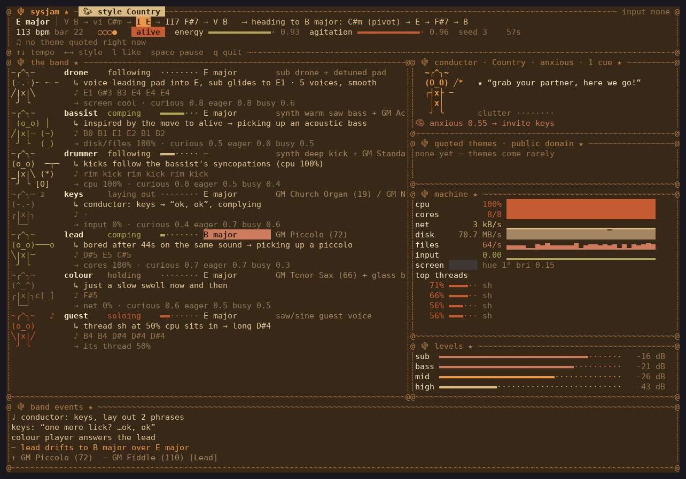 Country | 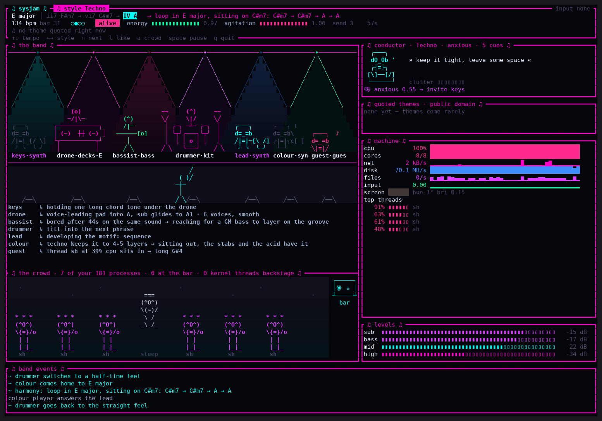 Techno | 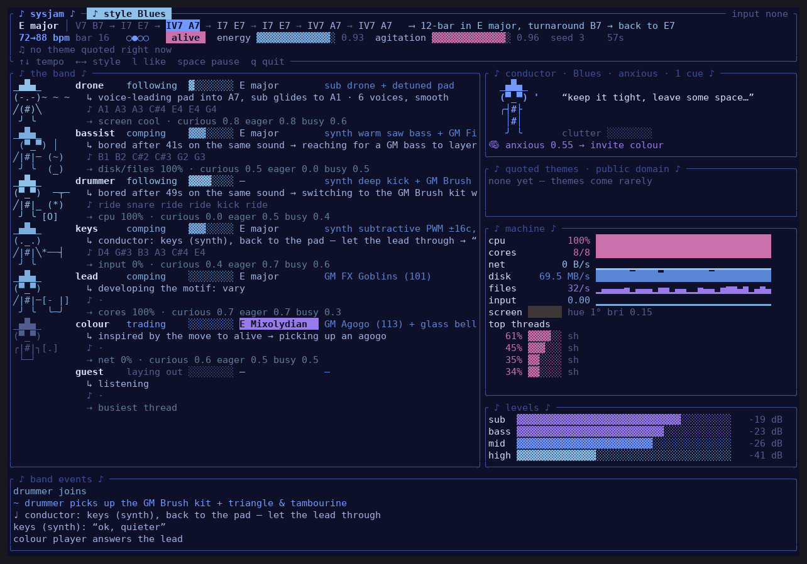 Blues |
| 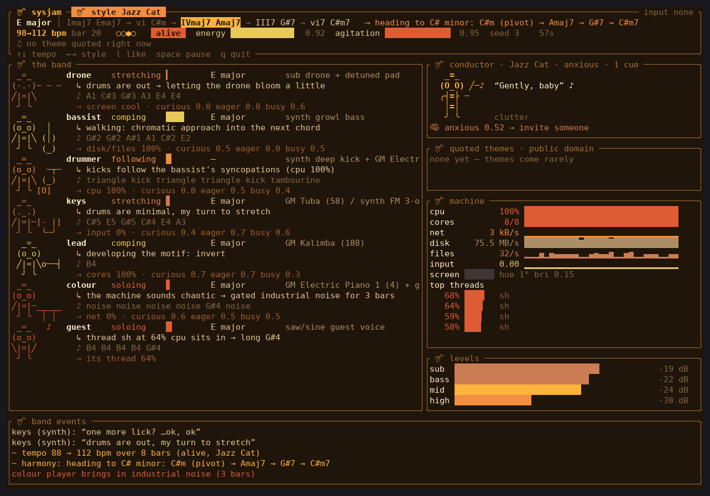 Jazz Cat | 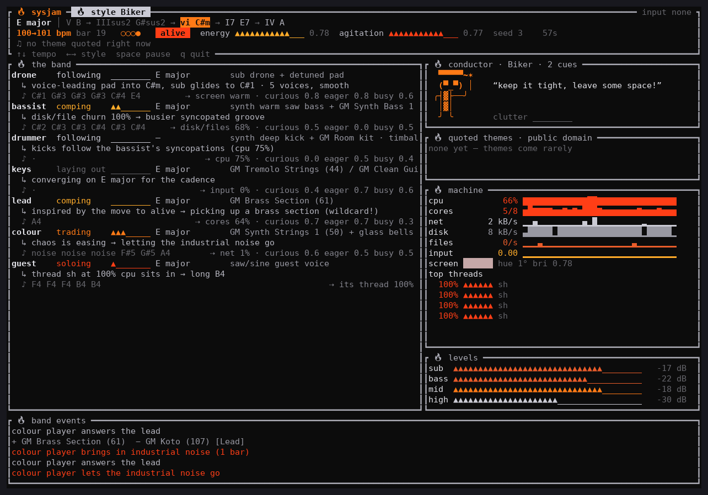 Biker | 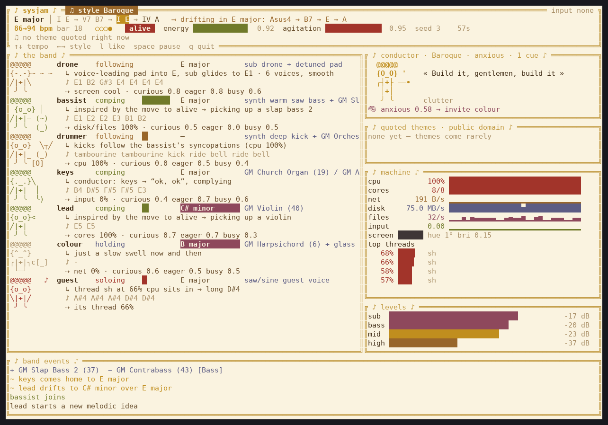 Baroque |
| 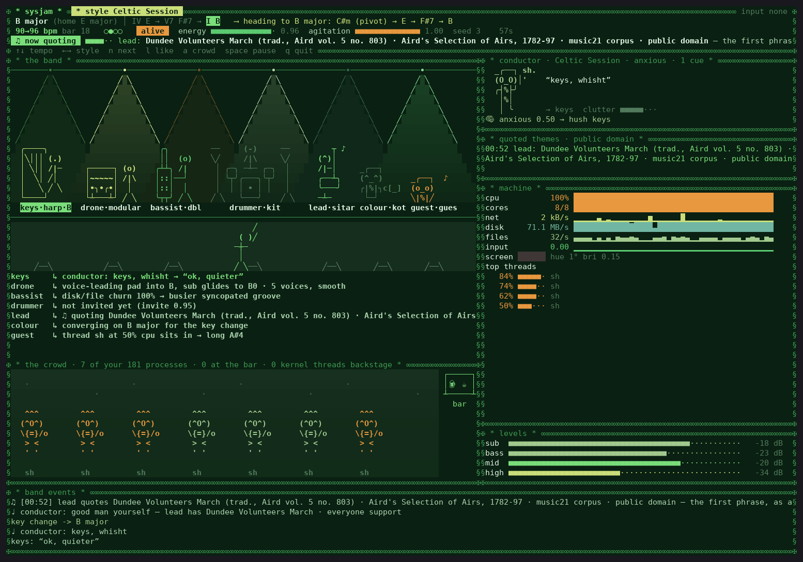 Celtic Session | 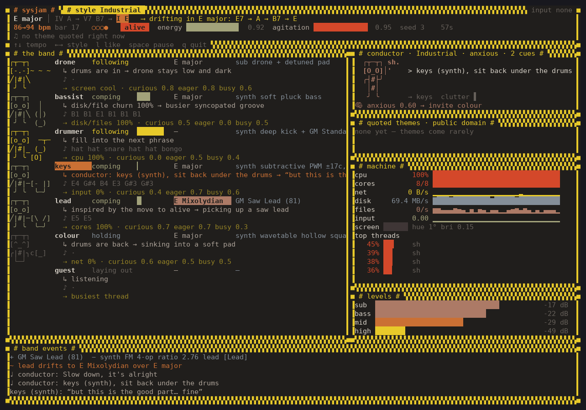 Industrial | 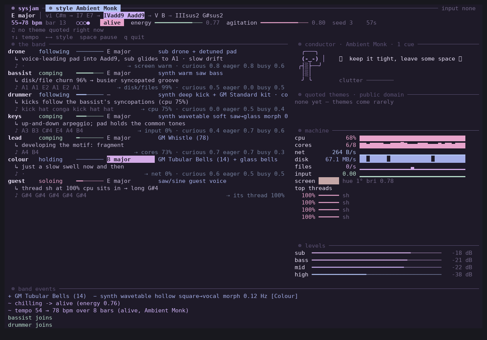 Ambient Monk |
| 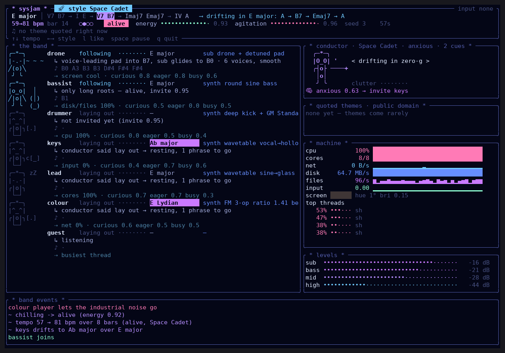 Space Cadet | 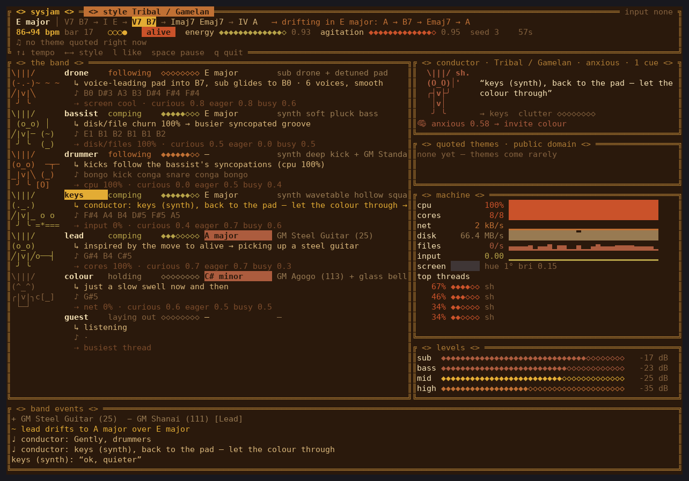 Tribal / Gamelan | 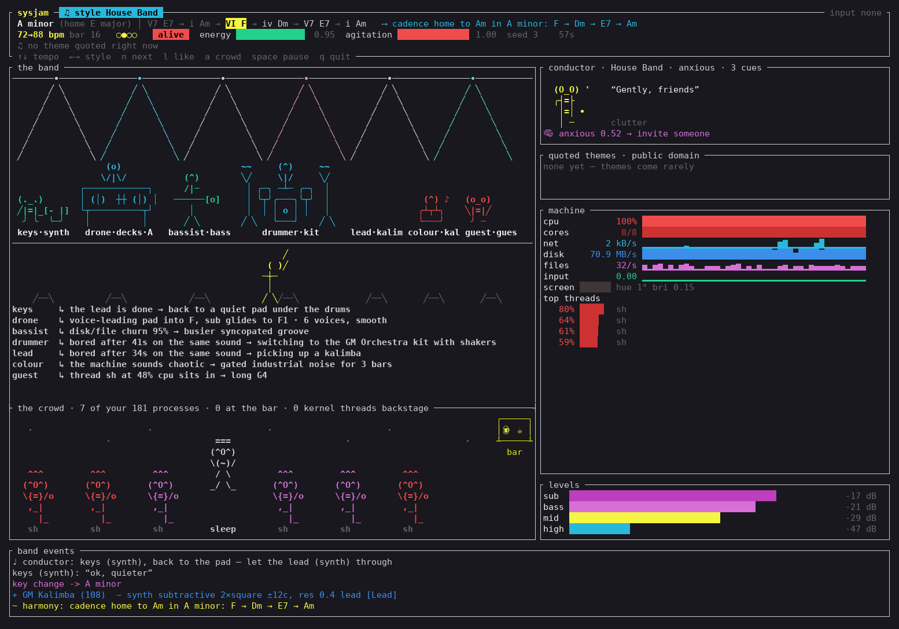 House Band |
| 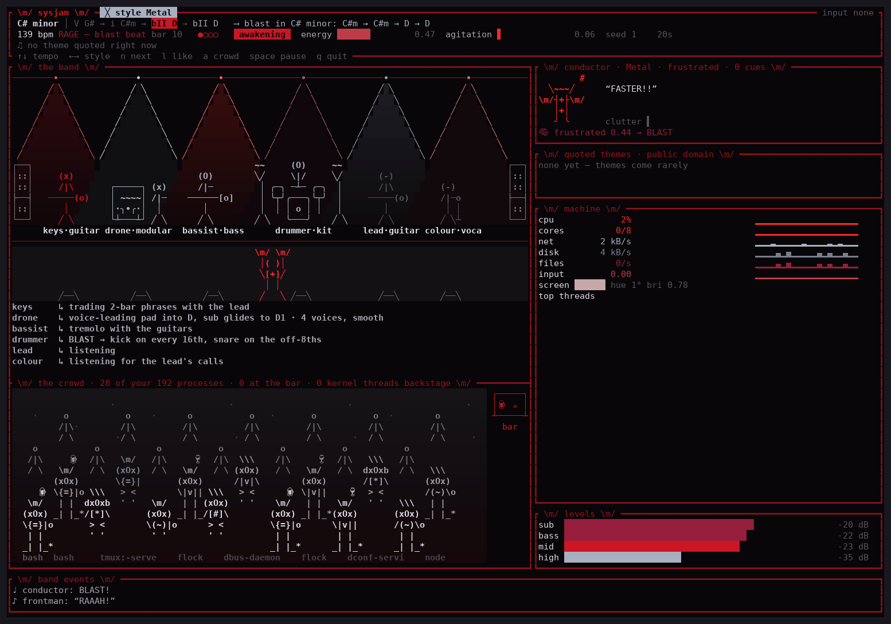 Metal | | |

**Scripted key presses** (tests): `SYSJAM_KEYS="20:right,45:up,46:up,150:left"` presses arrows at
the given seconds. In the offline bench (`SYSJAM_BENCH=1`) these are seconds of music time and the
bench prints a `bench steering:` summary (switches, nudges, techno sections, blue-note bends). In
a live run they are wall-clock seconds. The real keys were tested through tmux `send-keys Up/Left`
(crossterm raw mode).

**Harmony with memory and purpose.** The chord engine remembers the last 32 chords, keys,
cadences and tension levels. Each phrase gets a goal (authentic, half, deceptive or plagal cadence,
a climax, or free drift), chosen from what came before: a half cadence gets answered, the same
cadence twice in a row gets tired, tension builds and resolves. A beam search (width 16) then plans
the phrase towards that goal with functional harmony (tonic, predominant, dominant, secondary
dominants, borrowed chords; tritone substitutions and backdoor cadences in Jazz; pivot chords
for modulations), scored for voice leading, tension arc, the style's habits and novelty: it avoids
recent chords and bigrams and penalises A-B-A-B ping-pong. Now and then it calls back an earlier
phrase, transposed. Forms (the Blues 12-bar, Country changes, Techno loops) keep their shape.
The header shows the plan, for example:

- `heading to D minor: Dm (pivot) → Bbmaj7 → A7 → Dm7`
- `plagal landing Gm7 → Dm7 in D minor: Bbmaj7 → Fmaj7 → Gm7 → Dm7`
- `callback to the phrase from 6 phrases ago: F7 → Bbmaj7 → C7 → Fmaj7`
- `cadence home to Fmaj7 in F major: C7 → Am7 → Bbmaj7 → Dm7 → Bbmaj7 → Gm7 → C7 → Fmaj7`

Repetition over 12 runs of 600 s (6 styles × 2 seeds, free harmony only): A-B-A-B rate 3.72% → 2.12%,
repeated 4-chord runs within 32 chords 6.9% → 1.5%, distinct chord bigrams per 5 minutes 39.8 → 46.3.

## The audience: your processes on the dance floor

Under the band there is a dance floor with a crowd of **your own processes**, in **stacked rows**
(one person per 12 columns in each row, so about 9 per row on a 170-column terminal and up to 48 in
all), each a 5-row ASCII figure
with a short name tag such as `firefox` or `cargo` (exe name only, no pid; long names are cut to fit
the 11-cell slot).
Now and then the tag shows instead the name of a file the process has open (`notes.md`,
`spawn.log`): the base name only, never a path. At the right end is the bar (`🍺 ☕`, or `U c` in
ASCII). The panel title counts how many of your processes there are, how many are at the bar and
how many kernel threads stay backstage.

- **Who they are:** every exe name is hashed (FNV-1a) into a *persona*, so `firefox` always looks
  like the same person, on every run and every machine: hair or hat (spiky, bun, cap, beanie,
  top hat, mohawk, curls, bald …), clothes (hoodie, suit, stripes, dress, vest, jacket …), an
  accessory (headphones, earring, scarf, bag, a flower), height (short people have no knee row),
  and **their own dance vibe**, kept for as long as they're on the floor and different from their
  neighbours: a **hip shaker** (hands on the hips, the hips swinging out on every beat), a **hand
  waver** (hands up and waving on the eighths while stepping side to side), **hips and hands**, a
  **head bopper** (the head nods and sways on the beat, knees bouncing), a **stomper** (fists pumping),
  a **side-stepper** (step, together, step back), a **kicker**, a **twister** (heels in and out, the
  hips going the other way) and a **robot** (angular arms, a knee on every beat). Every one of them
  moves the legs and feet on the beat, twice as fast when the band is hot.
  The style's theme (cowboy hat, glowsticks, wig) goes over the top. Their **faces change with the
  music and what they are doing**: `(*o*)`/`(^O^)` when the band is hot, `(O)` mouths in a surge,
  `(^v^)` applauding a like, `(>o>)` when the process is CPU-hungry, `(@_@)` busy on disk, `('o')`
  chatting, `(^_^)`/`(-_-)` swaying to a chill groove, `(^-^)` waving goodbye, `(@~@)` dizzy, plus blinks.
- **The standout dancer:** now and then one person (far more often when the band is really going)
  breaks out and **roams through the audience**, crossing the rows and sliding along the floor,
  drawn a row brighter and on top, cycling through **spins** (the head turning round), **high
  kicks**, **slides**, **arm waves** rolling through the body and **jumps into the splits**, a new
  move every two beats; after 16–26 s they go back to their place.
- **Passing out:** rarely (one at a time, every few minutes at most) someone in the front rows
  keels over and **lies flat on the floor** `(x)[#]<` seeing stars for a while, then either gets
  back up a bit dizzy, is **crowd-surfed off** on a sea of hands `^ ^ ^`, or gets up and walks off.
  (`SYSJAM_CROWD_PASSOUT=SECS` and `SYSJAM_CROWD_STAR=SECS` force one at that time, for demos.)
- **Legs and feet, on the beat clock:** multi-frame cycles synced to the same beat clock as the
  band. A 4-frame walk cycle when coming in, going to the bar and leaving; foot taps on the beat;
  knee bounces; kicks, stomps and jumps with both feet off the ground (the whole figure lifts into
  the headroom row) during surges and hype. Each style has its footwork: a Country line-dance
  **grapevine** (the figure actually travels sideways) and heel-toe, a Techno **shuffle** and
  **running man**, a Blues **swing step**, Baroque **minuet** steps with pointed toes, a Biker
  **stomp**, a Celtic **jig** with high kicks. The musicians tap too, by style (country heel-toe,
  biker stomp, celtic eighths, blues on 2 and 4, baroque on beat 1, techno every beat), the
  **drummer's right foot comes down on the actual kick hits**, and the conductor shifts his
  weight every two beats and taps his foot (and bounces and stomps in surges).
- **Only when there is room:** the crowd panel shows by itself when the terminal is at least
  **160 columns × 55 rows** and disappears below that, coming back automatically when you
  resize. `a` forces it on or off.
- **A taller terminal grows the crowd, not the band.** The band panel keeps what the stage needs
  (30 rows) and the extra height goes to more stacked rows of people: 3 rows at 160×55 (the event
  log gives up a few lines for the third row), 4 at about 60 rows, 5 at 65, 6 at 70 and taller
  (2 rows on a squeezed crowd terminal, 1 at the minimum).

  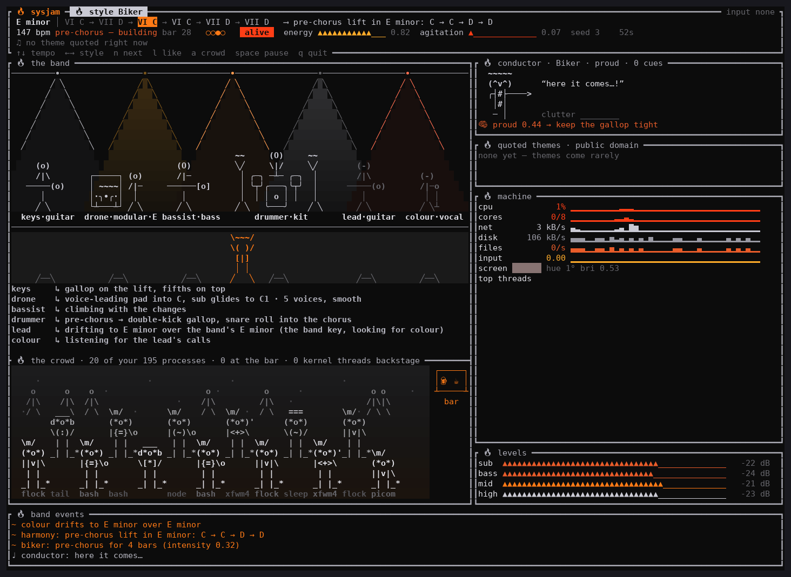

  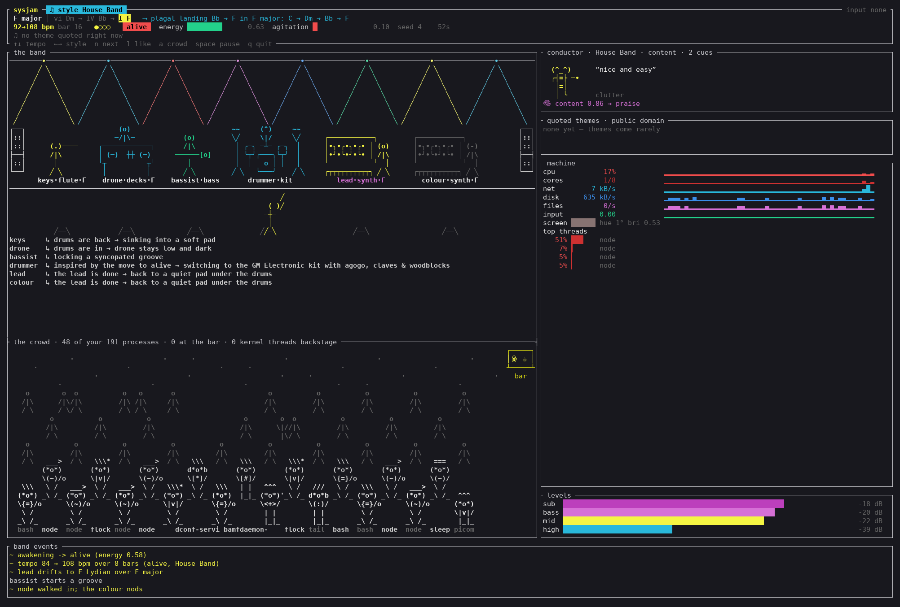
- **Who comes:** a rotating, CPU-weighted sample. Processes that start after sysjam ("fresh"
  ones: compilers, shell commands, a browser) get priority and **walk in** from the edge; an idle
  one goes home to make room. When a process exits its figure **waves and walks out**. Short
  spawns (a `cc1`, a `sleep`) pop in for a few seconds and leave again. Fresh spawns are let in
  at most one per 4 s, and not a second copy of a name already on the floor, so a shell that
  spawns all the time can't flood it. Kernel threads are only counted, never shown.
- **What they do, from real numbers:** CPU-hungry processes (over 50% of a core) dance hard; a
  little CPU makes them groove; nobody sleeps on the dance floor: a long-idle process that checks
  out just **waves and leaves**, and someone else comes in. Processes
  doing storage I/O (over 200 kB/s from `/proc/<pid>/io`, `read_bytes + write_bytes`) carry a box
  `[#]` over their heads; processes with a lot of other I/O (sockets, pipes, ttys and page-cache
  reads: `rchar + wchar` minus the storage part, which is the cheap stand-in for "network" a
  process can have) chat (`..`). Idle ones wander off to the bar now and then, have a beer `U` or a
  coffee `c` for 6–14 s and come back (at most two at the bar).
- **What they do with the music:** when the band is alive and hot, in a surge, or the crowd is
  roaring, everyone puts their hands up and jumps on the beat (from the same beat clock as the
  conductor). When it's chilling they mingle and nod. A like gets a round of applause. By style:
  a third of the crowd (the followers) picks up the style's own dance when the band is hot:
  cowboy hats and a grapevine in Country, glowsticks and the running man in Techno, a swing step
  with lighters in Blues, wigs, minuets and a polite golf clap in Baroque, a jig in Celtic; the
  rest keep dancing their own way. After `n` they cheer briefly.
  Industrial's wall of sound starts a mosh pit (headbanging hair flips, flailing fists, people
  shoved sideways, stomps); in Biker everyone throws the horns `\m/` and puts their fists up to
  sing along in the chorus; in Blues they swing-step on the shuffle and cheer the solos.
- **Depth:** each row stands 3 rows behind the one in front of it, so the legs of the back rows
  are hidden behind the heads in front (painted back to front: whoever is in front hides who is
  behind), and alternate rows are staggered by half a slot so faces peek through the gaps.
  **Everyone is full size**; depth comes only from colour: each row further back is dimmer, greyer
  and blended further toward the floor (precomputed per theme; 256-colour terminals get the
  nearest dimmer step), the front row is bright. If fewer full-size people fit, fewer come in.
  Name tags only for the two front rows; held-up items for everyone, dimmed with their row.
  Newcomers take the frontmost free spot. **People move between rows:** one at a time, someone
  steps forward while the band is hot and back toward the bar when it's chilling, and anyone
  going for a drink walks back through the rows and returns to a free spot. A floor gradient and
  a little drifting haze sit behind them. On ASCII / NO_COLOR terminals the rows are told apart
  by the overlap alone. To keep the UI cheap the front row moves on the eighths, the next row on
  the beat and the rows behind in half time, still on the beat.
- **Held up overhead, now and then:** a beer 🍺, wine 🍷, an eggplant 🍆 or a phone 📱 (filming, its
  screen glowing cyan in the big moments), swaying on the beat; lighters in Blues, glowsticks in
  Techno (alternating green and magenta). Only a few at a time, mostly while the crowd is hyped,
  in surges and choruses. Emoji are only used where a terminal draws them 2 cells wide (the
  in-between frames skip the covered cell); ASCII (or `SYSJAM_EMOJI=0`) gets `U`, `Y`, `@` and `[]`.
- **And back (lightly):** the crowd's excitement (how many there are × how busy × how alive the
  band is, smoothed over 6 s) adds at most 0.06 to the band's energy input. Above 0.55 the
  conductor may say so ("the crowd's into it!", at most every 2 minutes) and gets a small lift
  of delight. When a notable process walks in (a browser, an editor, a compiler, anything over 30%
  CPU) a musician nods: `~ firefox walked in; the keys nods`.

**Cost.** It reuses the monitor's existing `/proc/<pid>/stat` walk (every 1.5 s, already there
for the "top threads" panel), plus one `stat` of `/proc/<pid>` for the owner of each new pid,
`/proc/<pid>/io` for the people in the crowd (≤48), and every 6 s the `fd` links of one of them
(at most 48). Measured: 0.13 ms per census on top of the walk (≈0.01% of a core). The stacked
crowd is still diffed cell by cell (only cells that changed are sent); far rows move only on the
beat, the second row on the half-beat, and a deep crowd refreshes at ~6 fps between beats, so the
UI thread stays at about 0.45% in calm styles even at 220×70, and at 0.47–0.55% in Industrial's
mosh pit with 3–6 rows (the worst case), see [Performance](#performance).

**Privacy.** Process names and file names are only drawn (no pids any more) on your own screen; nothing is
logged, sent or stored. Only processes owned by your user are named, and only their file
descriptors are looked at (the kernel wouldn't show other users' anyway); other users' processes
and kernel threads are only counted. File tags are base names with no path, skipping `/dev`,
`/proc`, `/sys`, `/run`, `/usr`, hidden files, libraries, fonts, caches and lock files.
`--no-audience` turns the whole thing off (no scan at all); `a` forces the panel on or off. By
default it appears at 160×55 or larger (9 rows for one row of people: headroom for jumps, 5-row
figures, name tags; each extra row of people costs 3 more).

**Width-safe.** The crowd is pure ASCII; a unit test renders 12 exe names × every style × every
activity × every vibe × 24 frames of the beat clock (walks, jumps, grapevines included) and checks
that every row is exactly 7 cells wide, and that at least 10 of the 12 names get different looks.

## The conductor's feelings and his tiny brain

The conductor has a continuous emotional state: valence and arousal, plus a blend of 16 moods
with inertia: content, delighted, proud, amused, inspired, nostalgic (while a theme is quoted),
focused, impatient, frustrated, annoyed, bored, sleepy, anxious (chaos), surprised (sudden spikes),
tender and melancholy. Once a bar a feature vector of 32 numbers describes the moment (energy,
agitation, clutter, density, overlap, loudness, arrangement state, chaos, breakdowns, quotes,
minor/major, tempo, CPU/input/net/disk, spikes, stubborn players, bars since he last stepped in,
how many play, surge, build, a recent like, the style's strictness, a fresh cadence, harmonic
tension).

**What the model is, honestly:** a tiny multilayer perceptron, 32 → 32 → 16 → 30 (tanh), 8,404
bytes of weights compiled into the binary (`assets/conductor.bin`). It is not a language model
and does not understand music; it is a small learned function. It was trained offline
(`tools/train_conductor.py`, Python + numpy) on synthetic episodes, labelled by the hand-written
heuristic conductor plus a set of emotional rules (`src/mood.rs`), so it imitates and smooths those
rules (held-out agreement: mood 94%, intervention 97%, speech intent 98%). Its outputs are mood
logits, an intervention preference (none, hush, lay out, cue down, invite, build) and a speech
intent (praise, scold, encourage, joke, reminisce, hype, soothe). The mood he shows is 70% the
model and 30% the rules, sharpened and moved towards slowly (inertia), with jolts for surprises and
likes. One evaluation takes about 1–3 µs, once a bar: about 0.0001% of one core. Set
`SYSJAM_NO_BRAIN=1` to use the rules alone.

The model never acts directly. Its intervention preference only nudges the thresholds of the
existing conductor (for example "hush" lowers the clutter threshold for hushing from 0.45 to
0.36; "invite" makes inviting someone back more likely; "build" asks the harmony for tension and
lifts the band), and the hard rules always win: the deep sub and bass are never hushed, no hiss,
the drums are laid out only when the band isn't alive, the synth sits back while the drums play
(unless they rest), and restraint is kept.

His mood shows in his face and marks (sparkles, a sweat drop, an anger vein `#`, a tear, `zZ`),
in the size of his beat, in what he says (about 1,460 distinct lines, voiced per style), and in his
decisions: frustrated or annoyed he is stricter, delighted or inspired he invites players back
more. The players notice (`uh oh, he's frowning — playing it safe`, `he's beaming — let's give him more`).

Example trajectories (offline bench, seed 4, Jazz Cat; idle 40 s, busy 80 s, idle 80 s):

```
   0s focused 0.42 → soothe
  27s sleepy 0.87 → soothe          (chilling, nothing happening)
  54s anxious 0.40 → invite someone (the machine gets busy: chaos)
 109s anxious 0.51 → invite keys
 123s content 0.41 → praise         (the band settles into it)
 136s content 0.87 → praise
 151s nostalgic 0.74 → reminisce    (a theme is quoted)
 186s sleepy 0.87 → soothe          (back to idle)
```

## Likes: the only thing sysjam learns from

Press **`l`** (or Enter) when you like what you hear. sysjam takes a snapshot of the moment
(style, tempo, arrangement state, key and mode, which instrument families are playing, how
dense it is, who is playing, whether a theme is being quoted) and makes a small reward-weighted
update to a table of preferences. The conductor is delighted (`“Yeehaw! glad you like it!”`) and a
`♥` flashes in the header. From then on he steers towards similar moments: *auto* picks styles you
liked more often, tempo choices lean to tempos you liked, players pick up instrument families you
liked, modes you liked come up more, and liked quotes come more often. It is a gentle bias, not a lock.

**Nothing else is learned**, except a small negative from each **`n`** (next idea): the moment you
skipped is stored under `skips:` in the same file and nudges the style, state, tempo, mode and
density weights down by 0.06 (one like is worth about +0.3), spreading it over the alternatives.
Instruments, players and quotes are not touched by a skip. sysjam does not learn from switching
styles with ←/→, from how long you listen, from your typing, or from any other behaviour; only
presses of `l` and `n` count. Everything stays local:
the likes and the learned weights are written to `~/.config/sysjam/likes.yaml` (or
`$XDG_CONFIG_HOME/sysjam/likes.yaml`), plain human-readable YAML with a timestamp per like, loaded
at startup, never sent anywhere. Edit it or delete it any time, or run `sysjam --reset-likes` to
forget everything.

```yaml
learned_bias:
  style:
    "celtic": 1.800
    "jazz": -0.164
  tempo:
    "110-129": 0.675
    "70-89": 0.300
  mode:
    "major": 1.200
skips:
  - time: "2026-10-15T21:03:10-05:00"
    style: "House Band"
    state: "chilling"
    ...
likes:
  - time: "2026-10-15T20:42:33-05:00"
    style: "Celtic Session"
    tempo: 80
    state: "awakening"
    key: "F major"
    ...
```

A scripted test: six likes during a Celtic Session run, then four 20-minute *auto* runs (seeds 4,
7, 9, 13) with and without that file. Without likes, Celtic got 0% of the time in all four; with them
29%, 26%, 28% and 0% (21% on average). Time at 70–89 bpm went from 15% to 45% on average,
and guitar picks (a liked family) from 14 to 29.

## The band's own drive: an idle machine sounds good too

The band doesn't need load to play. The bandleader runs an **internal arc** per style, a
several-minute cycle: a valley (breathe), the rise (build), a long peak that dips once in the
middle (a breakdown or a solo space), then the fall. The arrangement state, the style machines
(the Blues shuffle and its solos, the Biker and Industrial song forms, the Techno sections, the
Country train beat) and the players' intensity all follow it, with zero system activity.

- **Load, input and the other signals are modulators, not gates**: the energy target is the arc
  plus up to 65% of the remaining headroom from the machine (`arc + 0.65·signals·(1 − arc)`),
  and load runs the arc's clock up to 1.8× faster. Spikes still inspire new sounds, CPU spikes
  still ask for tension, surges still come from fast typing.
- **Per style** (low, high, cycle): Ambient Monk 0.10–0.40 over 6 min (lush but never pushy:
  chilling/awakening only), Space Cadet 0.14–0.56, House 0.20–0.66, Baroque 0.18–0.68,
  Jazz/Celtic 0.20–0.76, Tribal/Country 0.20–0.78 over 4.5 min, Blues 0.22–0.85, Biker/Techno
  0.22–0.88, Industrial 0.22–0.90 over 4 min.
- **Fast first entrance**: the run starts just before the arc's rise; the first chill is a one
  phrase warm-up and awakening goes alive after two phrases once the energy is up. Techno's first
  drop is arranged straight away (8 bars of build, then DROP at about 30 s).
- **Deep bass everywhere**: the sub drone is no longer ducked in the synth-less styles (Blues,
  Country) and only lightly in Biker/Industrial.

Measured offline (`SYSJAM_BENCH_PROFILE=idle|loaded`, 600 s per run, seeds 1 and 2, TimGM6mb;
idle = 2–5% cpu with the odd disk write or packet and no input, loaded = 45–90% cpu, busy
disk/net and bursts of typing). States are chilling/awakening/alive/subsiding % of the time,
then melodic notes per minute, the mean number of players playing, the % of time the drums
play; the last column is the time to the style's signature moment on the idle machine (seed 1/2):

| style | idle before: states c/a/A/s %, melodic/min, players, drums on % | **idle now** | loaded now | idle signature (before → now) |
|---|---|---|---|---|
| auto | 100/0/0/0, 173, 3.1, 5 | **14/9/63/15, 383, 4.1, 43** | 0/2/98/0, 572, 5.0, 62 | first alive —/— → 37/34 s |
| house | 100/0/0/0, 85, 2.6, 0 | **15/9/64/13, 390, 4.1, 41** | 0/2/98/0, 569, 5.0, 52 | first alive —/— → 39/38 s |
| monk | 100/0/0/0, 70, 2.7, 0 | **21/67/0/12, 105, 3.8, 7** | 0/3/97/0, 368, 4.7, 29 | first alive —/— → —/— s |
| jazz | 100/0/0/0, 96, 2.3, 0 | **14/10/64/12, 415, 4.4, 42** | 0/2/98/0, 576, 5.1, 55 | first alive —/— → 32/32 s |
| blues | 100/0/0/0, 844, 6.0, 100 | **12/10/67/10, 1034, 6.0, 100** | 0/2/98/0, 1153, 6.0, 100 | first SOLO 33/32 → 32/32 s |
| country | 100/0/0/0, 89, 2.5, 0 | **15/10/62/13, 310, 4.1, 38** | 0/2/98/0, 400, 5.0, 56 | train beat playing —/— → 22/32 s |
| biker | 100/0/0/0, 538, 4.0, 100 | **12/8/71/10, 605, 4.1, 100** | 0/1/99/0, 663, 4.1, 100 | first CHORUS 22/22 → 22/22 s |
| baroque | 100/0/0/0, 82, 2.7, 0 | **15/8/64/13, 343, 4.1, 19** | 0/2/98/0, 474, 5.1, 28 | first alive —/— → 38/37 s |
| celtic | 100/0/0/0, 90, 2.5, 0 | **15/11/62/12, 416, 4.3, 30** | 0/2/98/0, 599, 5.1, 57 | first alive —/— → 35/34 s |
| industrial | 100/0/0/0, 321, 4.5, 100 | **13/8/69/9, 382, 4.6, 100** | 0/1/99/0, 708, 4.8, 100 | first RAGE wall 16/16 → 16/16 s |
| techno | 100/0/0/0, 327, 4.1, 10 | **10/8/72/10, 537, 4.2, 70** | 0/1/99/0, 730, 4.4, 89 | first drop —/— → 31/31 s |
| space | 100/0/0/0, 72, 2.8, 0 | **16/10/64/10, 324, 4.1, 28** | 0/2/98/0, 462, 4.9, 46 | first alive —/— → 44/58 s |
| tribal | 100/0/0/0, 91, 2.6, 0 | **17/11/59/13, 365, 4.1, 30** | 0/2/98/0, 551, 5.0, 59 | first alive —/— → 37/36 s |

Dead air on an idle House run fell from 14.7% to 1.4% of the time (`bench deadtime`), and the
sub band (<90 Hz) now sits at −19 to −21 dB in every style, idle or loaded (Blues was −25.4 dB
idle, Country −21.7). `SYSJAM_BENCH_PROBE=file` logs one line per second (state, feel, section,
players, notes, energy, loudness, sub level).

## Next idea, and never dead air

**`n` / Tab: next idea, now.** When it's going nowhere, press `n` (or Tab). Within about a beat
(measured 0.33–0.42 s from key to new harmony on screen), the band:
- jumps to a **new key** away from the recent ones (`next idea: modulation straight to F# minor`);
- starts a **new progression** and writes a **new motif**, new comping and new bass, drum and acid patterns;
- picks **new sounds for at least half of the band**;
- lifts any lay-outs, brings two melodic players straight in with full phrases, and the drummer plays a fill if he's in.

The conductor says `“right, moving on!”` (then `“ok — next idea!”`, `“fresh page, here we go”`, …),
the crowd cheers lightly, and the moment you skipped is stored as a small negative in your
likes file (see [likes](#likes-the-only-thing-sysjam-learns-from)). It also works offline: `SYSJAM_KEYS="30:next"`.

**Why there was dead time.** Measured in 20-minute offline auto runs (6 seeds, `SYSJAM_BENCH=1
SYSJAM_BENCH_SCALE=6`: 4 min idle, 8 min busy, 8 min idle), 70–84% of the no-melody time was in
*chilling*. Keys and colour rested, the lead was rarely invited, chill chords changed only every 4–5
bars, the conductor had a habit of "dropping to the drone", and *hold* notes were often swallowed.

**What changed.**
- A **floor**: at least one melodic voice playing and at least two of keys/lead/colour in, always;
  the drone/pad is always evolving (pad voices drift each bar, deeper LFO when chilling).
- **Restraint means fewer notes, not silence**: a lay-out comes with an invite (`keys, back to the
  pad — lead, you take it`), the drone cue became `“everyone, softer — let the drone breathe”`.
- **Lush chilling**: chords every 1–2 bars, more colour swells, rolled-chord holds, the lead calls in every phrase.
- A **stagnation detector** (same chords, same players, same sounds, flat energy) shows its reason
  and makes a change: a new section, a key change, a featured soloist, call and response, or a build
  (`getting stale — new section`), so something contrasting happens every 1–3 minutes.
- **No lone "dumb notes"**: a keys/lead/colour player only enters at a phrase start or pickup, with a
  complete statement (a 3+ note phrase with contour, no gap over a beat and a half, ending on a held
  chord tone, or a full comp pattern of at least a bar), and finishes it unless a style switch or `n`
  cuts in; thinning shortens phrases instead of deleting notes from them. Single hits are only for
  programs that make sense alone (bird tweet, seashore, tubular bells, glockenspiel, timpani, gongs,
  FX, reverse cymbal, long pad/drone swells), placed on strong beats or chord changes.

**Before → after** (same 6 seeds, 20 min each; *dead* = fewer than 2 voices or nothing new for 4 s;
an *orphan* is a melodic/comp note with no other note from the same player within 2 beats either side):

| metric | before | after |
|---|---|---|
| dead time | 21.6% (13.4–26.7) | **4.2%** (3.1–5.0) |
| no melodic voice | ~52% | 29.5% (25.9–33.8) |
| fewer than 2 players | ~38% | 5.6% (0–9.3) |
| stagnant bars | ~12% (4–25) | **0.9%** (0.5–1.8) |
| longest stretch without a section change | 99–217 s | 86–88 s |
| median gap between section changes | ~25 s (15–42) | 34 s (28–39) |
| orphan notes per 10 min | 47 (36–63), 15% of melodic/comp notes | **8** (5–15), 1.6% |

The bench prints these lines itself (`bench deadtime:`, `bench sections:`, `bench orphans:`), plus
why there was no melody (`keys off/lay/rest/hold/gated …`). `SYSJAM_NO_DEVELOP=1` turns the
stagnation detector off for comparison; `SYSJAM_ORPH_LOG=1` lists every orphan note.

## The band

Each player has a personality, drawn from the seed: eagerness, busyness,
swing, how often it replies, and register. On every bar each player decides
whether to **lay out, comp, follow, solo or trade**. The decision depends on
the bandleader's invitation, the shared energy and what the others are doing.

| Player | Plays | Listens to |
|---|---|---|
| **Drone / landscape** | Continuous sub drone (detuned sine pair at 30–60 Hz plus 2nd/3rd harmonics, gliding to each chord root), and a voice-led detuned pad (low-mids). Never lays out. There is no constant hiss/air bed | energy, screen brightness |
| **Bassist** | Roots and fifths at 40–120 Hz, in three styles: long notes, pulsing roots, or a syncopated groove. Plays approach notes into the next chord. Heavy file/disk activity makes it busier | file + disk writes, the drummer |
| **Drummer** | Synth kick, plus the GM kit (channel 10) when a SoundFont is loaded. **Minimal by default**: decides every phrase to rest, play a minimal part (soft downbeat and a tick or shaker pair) or groove — groove mostly when alive, always in surges. Locks onto the bassist's syncopations, occasional fills before section changes, crashes on entries | CPU, cores, the bassist |
| **Keys** | GM pads hold chord tones (common tones are kept between chords). Keys/plucks play arps, broken chords or offbeat comping, and take solos when invited | energy, the lead (trading) |
| **Lead / melody** | Sparse two-bar call phrases built from a motif it develops (repeat, sequence, invert, vary, fragment, new idea). Rests between phrases, and resolves the melody before laying out | agitation, colour player, keys |
| **Colour / FX** | Bells, shimmer clouds driven by network traffic, swells, odd GM colours (FX Atmosphere, Seashore, …). Answers the lead's phrases. **Industrial texture:** only when the band hears real chaos, i.e. agitation above 0.68 for 6 s, or alive with 3+ hot signals at once, or a rare deliberate colour move while alive. It is 1–3 bars of gated, rhythmic band-passed noise with a metallic resonance (peak ≈ 0.018, about −12 dB under the old continuous air bed and gated, so it averages far lower). It fades out as soon as things calm down, then waits 25 s before it can come back | network, the lead, chaos |
| *Guest* | A **featured sit-in with the style's own instrument**, playing complete solo phrases over the harmony (a stepwise line with leaps, chord tones on the beats, landing on the root or third at the end of each phrase), trading two bars on and two off for 12 bars: House **sax**, Ambient Monk **shakuhachi** (long breaths), Jazz **trumpet** and Blues **tenor sax** (swung, the odd blue third), Country **fiddle** and Celtic **uilleann pipes** (with cuts), Biker **lead vocal**, Metal **shred guitar** (sixteenth-note sequences ending on a held note), Industrial **screamer** and Techno **vocal-chop MC** (chopped sixteenths), Baroque **recorder**, Space Cadet **theremin** (our own gliding sine with a wide vibrato), Tribal/Gamelan **suling**. On an idle machine the band's own arc brings one in at its featured moments (solo and chorus sections, the loud sections, a hot arc), about every 1.5–3 minutes; a thread using >40% of a core for >10 s makes one come in within two bars and more often (16 bars, 12-bar gaps), and the guest takes that program's name (`guest: firefox on fiddle`); otherwise it's the busiest of your programs. The guest plays on its own small GM synthesizer that only renders while it plays. `--no-leads` turns it off | the band's arc, a busy program |

**Restraint: play only when there's something to add.** Players are calm by
default. At every phrase, keys, lead and colour each decide to **play**, **hold**
a single sustained tone, or **rest**. The decision weighs:
- the arrangement state (chilling leans towards fewer notes, but never towards silence);
- the player's tied signal, and whether it just changed;
- how dense the rest of the band already is;
- novelty: a freshly picked-up sound counts in favour, while playing many phrases in a row ("fatigue") and doubling another player count against.

The reason shows in the thinking line, e.g. `band is busy enough (9 notes/bar) → nothing useful to add, resting`,
`holding one long chord tone under the drone`, or `my signal is up (net 92%) → worth playing`.

In **chilling**, players thin out by playing *fewer, shorter phrases*, not by going silent: there is
always at least one melodic voice and at least two of keys/lead/colour in, the pad keeps drifting,
chords change every 1–2 bars, colour swells come more often and the lead keeps calling (see
[never dead air](#next-idea-and-never-dead-air)).

Patterns are sparser overall:
- keys: mostly sparse stabs; arpeggios in quarters, eighths only when alive;
- lead: a two-bar call per phrase, a connected statement of 3+ notes ending on a held chord tone;
- colour: a few shimmer bells per bar at most;
- drone: rarer landscape bells;
- drums: see below — rest or minimal unless alive; hats in quarters, eighths only when really alive, no sixteenths outside surges.

Surges and alive moments stay energetic, mostly through the bass and drums.

**The synth stays in the background, and trades space with the drums.** The
self-designed synth patches and the drone's detuned pad bed are background voices:
- they sit **10 dB under GM** (`SYN_TRIM`), with slow attacks, long releases, lower
  cutoffs, gentler resonance and FM index;
- at control rate every synth voice (per player) and the pad bed pick a *space*:
  - **duck** while a GM instrument, the lead or a theme quote is sounding: a further
    −8 dB and the filter closes (≈900 Hz on the patches, the pad's cutoff ×0.45);
    short notes are dropped, only long tones remain;
  - **back** while the drummer is grooving: −2 dB, filter at ≈2.6 kHz, notes become
    pad-like (short ones mostly dropped, the rest doubled in length);
  - **stretch** when the drums are resting or minimal and nobody else is up front:
    +4 dB, filter open, and more notes get through — `“drums are out, my turn to stretch”`.
- The drummer rests far more: chilling never, subsiding mostly out, awakening rest or
  minimal, alive groove about half the time (more with a hot CPU signal); after three
  phrases of playing it gets tired and drops out to “let the synth have a go”.

The thinking lines say what is happening, e.g. `drums are back → sinking into a soft pad`,
`lead is up front → ducking under it, filter closed`, `drums are out → letting the drone bloom a little`,
`minimal: a soft downbeat and a tick, nothing more`.

**Mix before vs after** (offline 200 s bench with `SYSJAM_RMS=1`, seeds 1–4, RMS in dBFS
per source over the time the drums were playing or resting; ranges across the seeds):

| source | drums playing, before → after | drums resting, before → after |
|---|---|---|
| **synth bus** (patches + pad bed + bells) | −21.4…−22.0 → **−33.5…−34.8** | −20.1…−20.3 → **−27.9…−29.3** |
| drone pad bed | −22.0…−22.3 → −34.3…−37.0 | −20.4…−20.6 → −28.0…−29.9 |
| synth patches | −30.0…−35.6 → −36.4…−42.9 | −32.0…−35.2 → −38.1…−48.5 |
| GM melodic voices | −17.8…−26.7 → −17.5…−26.0 | −40.9…−54.2 → −23.1…−31.1 |
| GM drums | −20.4…−24.0 → −23.1…−27.5 ¹ | — |
| synth bus relative to GM melodic | −4…+5 dB → **−9…−16 dB** | |

¹ −13 dB in one run where a surge played a TR-808 kit; surges stay loud on purpose.
With the drums playing, the synth now sits 9–16 dB under the GM instruments, where it
used to be level with them. When the drums rest it comes forward by about 6 dB, still
8 dB under its old level. Drums rest for 104–145 s of the 200 s, up from 97–105 s.

**Drum density** (notes/min, same benches): alive 321–560 (mean 405) → 160–234 (mean 190, −53%);
awakening 120–201 → 0 (rest or minimal); subsiding 49–63 → 0–17.

**The conductor.** Every bar the conductor listens to the whole band:
- note density of keys + lead + colour against a state target (about 1.5 notes/bar chilling, 4 awakening, 8 alive, 2.5 subsiding, 5 in a surge);
- players crowding the same register within two beats, and players stepping on the lead;
- the mid/high share of the output spectrum, and the loudness.

When the mix gets out of control it steps in, at most every 8 s and never nagging one player more than every 20 s:
- **hush** the worst offender: velocity down, and short notes thinned out by half, for 2 phrases;
- tell it to **lay out** for 1–2 phrases (repeat offenders, or bad clutter);
- **cue** the band when things are badly out of hand: `everyone drop to the drone` (chilling/subsiding; the bassist goes to long notes) or `bass and drums only`;
- **invite** a resting player back (`keys, come back in — softly`) when space opens up.

It also enforces the synth/drums trade:
- the **synth is the first to be hushed** when others play: `keys (synth), back to the pad — let the lead through`,
  or `colour (synth), sit back under the drums` (synth players score extra as offenders whenever a GM voice, the lead or the drums are going);
- outside alive moments and surges, a grooving drummer is told `drums, give it some air — synth, take the space` (lay out 2 phrases);
- when the drums lay out it **invites the synth in**: `drums are out — keys (synth), stretch a little`;
- during a theme quote it backs the quoting player: `nice — lead has Wachet auf, ruft uns die Stimme · everyone support`, and afterwards `lovely. back to it`.

Players respect it, but stubborn ones (high eagerness/busyness) grumble first and comply a bar later:
`conductor: keys (synth), lay out 2 phrases → “one more lick? …ok, ok”`.
Soloists are left alone. `SYSJAM_COND_LOG=1` prints the conductor's measurements every phrase on stderr.

**Note density, before vs after** (offline 200 s bench, `SYSJAM_BENCH=1`, time-weighted over seeds 1, 5, 11 and 23, notes per minute):

| player | chilling before → after | alive before → after |
|---|---|---|
| drone (pad voices that move + sub glides) | 21 → 22 | 69 → 80 |
| bass | 5 → 5 | 155 → 179 |
| drums | 0 → 0 | 480 → 303 |
| keys | 15 → 6 | 216 → 89 |
| lead | 4 → 5 | 27 → 21 |
| colour | 37 → 9 | 72 → 28 |
| **total** | **83 → 48 (−42%)** | **1018 → 700 (−31%)** |

Across the four runs the conductor stepped in 11 times: 7 hushes, 2 lay-outs and 2 invitations back, with 3 grumbles. Restraint alone keeps most phrases tidy, so the conductor only acts when a player really overdoes it.

**Bandleader / arrangement.**
- **Energy** is a 15 s average of the system signals; **agitation** is a 3 s average.
- State changes only happen on phrase boundaries (4 bars). Each state must be held for 3–4 phrases (~36–48 s) before the next change; the thresholds have hysteresis:
  - chilling → awakening at energy > 0.22, or straight to alive on a big multi-signal spike;
  - awakening → alive at > 0.42;
  - alive → subsiding at < 0.30;
  - subsiding lasts 8–19 bars and peels players off: drums first, then the lead resolves, then the bass. It goes back to awakening if energy returns.
- Entries come with drum fills or noise risers.
- Surprises happen at most every 4 phrases: a solo (keys, lead or colour), a breakdown (drums and bass drop out), a bandleader key change, or a lone instrument in chilling.

**Harmony** is independent of the OS. Every 1–2 bars (`--chord-bars`) the
progression moves using 4- and 8-chord phrases drawn from weighted templates:
- major: I–V–vi–IV, vi–IV–I–V, ii–V–I, I–vi–IV–V, I–IV–vi–V, IV–I–V–vi, I–iii–IV–V, IV–V–iii–vi, and two 8-bar forms;
- minor: i–VI–III–VII, i–iv–v–i, i–VII–VI–VII, Andalusian i–VII–VI–V, i–iv–VII–III, i–III–VII–iv, VI–VII–i–i, i–VI–iv–V, and two 8-bar forms.

In chilling the band "meanders" through a Markov graph built from the same templates (every template step is a weighted edge).

About 13% of phrases take a **detour**:
- a secondary dominant (V/x), a borrowed chord (bVI, bVII, iv in major; IV or V in minor), or a colour phrase (sus2/sus4/add9/7ths);
- an occasional **modulation**: to the relative key via a pivot chord, to the parallel major or minor, or a fifth up or down around the circle of fifths via pivot → V7 → new tonic. Screen colour biases the new key's mode: warm/bright screens favour major, cool/dark favour minor.

**The home key isn't sacred.** Once a new key has lasted about 3 phrases, it can
become the new home (40% chance per phrase). The band then confirms it with a
V7 → I cadence and logs `~ new home key: D major (was A major)`. The pull back to
the old home is weak and builds only after about 6 phrases away. Over a long session
the key wanders.

**The tempo breathes.** At phrase boundaries the bandleader may set a new
target tempo, depending on the arrangement state and its agitation:

| state | tempo range |
|---|---|
| chilling | 58–76 bpm |
| awakening | 72–96 bpm |
| alive | 90–128 bpm |
| subsiding | drifts 4–14 bpm lower per move |

The tempo never jumps. It ramps smoothly over 2–8 bars (at most 24 bpm per ramp), one tiny step-length change per sixteenth, so the step clock stays glitch-free. The echo time follows the tempo, gliding one sample at a time. Sometimes the drummer plays a phrase or two in **half-time** or **double-time** feel. `--bpm N` locks the tempo; feel moves still happen.

**Surges.** Every so often the band opens the throttle. A surge is rare: the
first one can come after about 40 s, later ones at least 2.5 minutes apart. It only
starts while the band is awakening or alive (or from any state when the typing is
racing), and it is much more likely when the band is alive or the typing is intense. When it fires:
- the tempo ramps to 120–150 bpm over 2 bars, holds for 2–4 phrases, then winds back down over 6 bars to the middle of the state's tempo range;
- the drummer drops into a lopsided Harley-Davidson V-twin **"potato-potato" lope**: long-short pairs of deep kicks (38–47 Hz bodies) and floor toms on sixteenths 0, 3, 8 and 11, with a soft rim;
- the bassist thuds the root on the same long-short pulse with a growl patch;
- a low-passed **throttle-rev swell** (a rising 33→75 Hz rumble) opens the surge and some phrases inside it, and a falling one closes it;
- the TUI shows the feel as `surge — V-twin lope`, and the drummer's thinking line explains it, e.g. `the typing is racing → opening the throttle to 138 bpm: V-twin lope, long-short low kicks + floor toms`.

Nothing in a surge is high-passed or noisy: it is all low end. `--bpm` keeps the tempo locked, but the lope still happens.

**Every player has its own key.** The bassist and drone anchor the band key. Keys,
lead and colour each carry their own key and mode, related to the band's, and
they listen to the others:
- At phrase boundaries a player may wander, guided by its *adventure* trait, to the relative or parallel key, a fifth up or down, or a brighter or darker mode (Lydian, Mixolydian, Dorian, Phrygian…). The TUI shows e.g. `drifting to E Dorian over the band's A minor`.
- Adventurous players can go **bitonal** (a tritone or a major third away), but only in chaos.
- Notes outside the player's own scale snap to the nearest scale tone. Every note is scored for roughness against the bass and pad, and a player that hears too much steers back (`heard roughness against the bass/pad … → steering back`).
- At cadences, phrase ends and key changes everyone converges on the band key again.
- In minor keys the raised 7th is spelt as a sharp (G# in A minor, C# in D minor), and keys are spelt the conventional way (E♭ minor, not D# minor).

The voicing keeps common tones and moves the other voices by the smallest
interval. The bass follows chord roots; shimmer, arps and the lead use chord
tones.

**System events push the band; they never drive notes directly.**
- CPU > 65% for 5 s → tension: the next chord becomes a V7, a secondary dominant or a borrowed chord (40 s cooldown).
- A net or disk burst (> 0.7 for 4 s) → modulation (90 s cooldown).
- Going back to idle after a busy stretch → a cadence resolving to the tonic (60 s cooldown).

`--verbose` shows all of this, rate-limited. For example:
```
Key: A minor | Am → E → Em7 → Asus2
~ sustained CPU spike -> tension
Key: A minor | E → Em7 → Asus2 → A7   (tension: A7 (V/Dm7))
~ chilling -> awakening (energy 0.48)
bassist joins
drummer joins
+ Warm Pad (89)  − Sweep Pad (95) [Pad]
Key: E major | A7 → Dm7 → B7 → E   (modulation: A minor -> E major)
keys takes a solo
```

## Themes: public-domain quotes, always cited

Every now and then a player gets inspired and quotes a well-known tune, woven into
whatever the band is playing. It happens rarely: on average a couple of times in 10–15
minutes, more likely when the band is awakening or alive, with a 100–200 s pause after
each episode. Only one theme is in the air at a time.

- **Transposed and adapted**: the theme is stored as scale degrees, so the player maps it
  into its *own* key and mode. A major tune turns minor in a minor key, Dorian in a Dorian
  key, and so on. Chromatic notes are kept only when the modes match. Durations are in
  beats, so it follows the band's tempo.
- **Variations**: a straight quote; a fragment (the first half); augmented, as a slow
  pad melody (keys/colour); diminution, twice as fast (lead, only when alive); inversion;
  call and response (the lead plays the first phrase, someone else answers with the
  second); or the bassist plays it low.
- **Passed around**: when a quote ends, another player may pick up a fragment, an
  inversion or the bass line of the same theme (at most two passes).
- **Woven in**: quotes are played softly (velocity ≈45–55). The quoting player is
  featured for the duration. The others are hushed to support it, and the synth voices
  duck under it.
- **Cited, every time**, in the terminal:
  - the quoting player's thinking line: `♫ quoting Wachet auf, ruft uns die Stimme (J.S. Bach, BWV 140.7) · music21 corpus (Bach chorales) · public domain — augmented, as a slow pad melody, in Eb major`;
  - the persistent `♫ now quoting` header line, for as long as the quote lasts;
  - the *quoted themes* panel (a scrolling history);
  - the band-event log. Citation lines start with `♫` and are **also printed with `--no-tui`**, even without `--verbose`:
    ```
    ♫ [04:13] lead (synth) quotes Kathleen O'Moore (trad., O'Neill no. 110) · O'Neill's Music of Ireland, 1903 · music21 corpus · public domain — a straight quote, in G# minor
    ♫ [04:21] bass picks up Kathleen O'Moore (trad., O'Neill no. 110) · O'Neill's Music of Ireland, 1903 · music21 corpus · public domain — low in the bass (passed on), in G# minor
    ```

**Where the themes come from.** `tools/extract_themes.py` reads a curated selection
from the corpus bundled with [music21](https://github.com/cuthbertLab/music21) 10.5.0. For each tune it
keeps only a 2–8 bar incipit (Bach chorales: up to the first fermata) as melodic facts:
scale degrees relative to the tonic, durations, mode, meter, pickup, title and citation.
It writes them to `assets/themes/themes.txt` (371 themes, 78 KB), which is embedded in the
binary with `include_str!`. **The binary does not need Python or music21.**

**Licensing: public domain only.** A source is used only if the composition is public
domain *and* the corpus files carry no restrictive notice. No encoding text is copied.
Details, transcriber credits and the reasons for every exclusion are in
[`assets/themes/LICENSE`](assets/themes/LICENSE).

| source | themes | status |
|---|---|---|
| J.S. Bach chorales (BWV numbers from music21's chorale lists) | 120 | composition PD; files have no rights notice (credit for Margaret Greentree's PDF edition noted) |
| Beethoven string quartets (Op. 18, 59, 74, 132, 133) | 15 | PD; no rights notice |
| Haydn string quartets (Op. 1 No. 1, Op. 74 No. 1) | 9 | PD; no rights notice |
| Mozart (K. 80, 155, 156, 458 “Hunt”, 545) | 16 | PD; no rights notice |
| Handel, “Lascia ch'io pianga” (Rinaldo, HWV 7) | 1 | PD; no rights notice |
| Ryan's Mammoth Collection (Boston, 1883) | 110 | traditional, PD; ABC transcriber credits only |
| O'Neill's Music of Ireland (Chicago, 1903) | 60 | traditional, PD; ABC transcriber credits only |
| Aird's Selection of Airs (Glasgow, 1782–97) | 40 | traditional, PD; ABC transcriptions credited to Jack Campin |
| **total** | **371** | |

**Excluded:**
- Essen folksongs: non-commercial permission only;
- Ciconia and Luca: CC-BY-SA 3.0 editorial transcriptions, not GPL-3 compatible;
- Trecento: editorial transcriptions with no stated licence;
- Palestrina: John Miller copyright;
- Monteverdi: Ut Orpheus ©;
- Beach: CC-BY-SA engraving;
- Schubert and Clara Schumann: bare © notices;
- the lead sheets: one is “All Rights Reserved”;
- Joplin: an unverifiable musescore.com upload.

Regenerate with:
```bash
pip install --user --break-system-packages music21
python3 tools/extract_themes.py            # → assets/themes/themes.txt
```
`SYSJAM_QUOTE_TEST=1` makes quotes come every ~25 s, for demos and screenshots.

## General MIDI instruments (SoundFont)

Instruments come from a GM `.sf2` file played by rustysynth (polyphony
capped at 28, reverb/chorus off). The file is found in this order:
1. `--soundfont PATH`
2. system paths: `/usr/share/sounds/sf2/FluidR3_GM.sf2`, `/usr/share/soundfonts/FluidR3_GM.sf2`, `default-GM.sf2`, `TimGM6mb.sf2`, `GeneralUser_GS.sf2`, any `/usr/share/soundfonts/*.sf2`
3. `~/.local/share/sysjam/*.sf2`
4. `TimGM6mb.sf2` (or any `.sf2`) next to the binary or in an `assets/` directory beside it or above it. **This file is shipped in this repo as `assets/TimGM6mb.sf2`**, so a source checkout finds it automatically.

If none is found, the band plays its oscillator instruments only and prints
one hint line: `sudo apt install fluid-soundfont-gm` (FluidR3, 140 MB, sounds
better than TimGM6mb).

Picks are weighted across **all 128 programs**: every program has a real
weight in at least two roles (pad, comp, lead, colour, bass). On top of that,
each player draws a **signature palette** from its personality (ethnic plucks;
brass, reeds & organs; synth leads & FX; mallets & bells; strings & voices; keys
& guitars; winds & pipes; oddballs & sound FX). It favours that palette, with an
occasional wildcard from anywhere. Per-program gain is kept narrow (0.75–0.95), so
oddballs are audible, and the GM layer rises with the band's energy so it sits
in front of the oscillator bed.

The **drummer** switches between GM kits (Standard, Room, Power, Electronic,
TR-808, Jazz, Brush, Orchestra) and auxiliary percussion sets (shakers,
congas & bongos, agogo/claves/woodblocks, triangle & tambourine, timbales &
cowbell).

**Every player can play GM or synthesize.** Each has a *synth* trait (sample vs
synth preference). When inspired, it picks either a GM program or a patch it
designs itself, with parameters drawn from its personality and its tied signal.
There are four engines:
- **subtractive**: detuned saw / square / PWM into a resonant filter with its own envelope;
- **FM**: 2–4 operators with a decaying index (bells, e-pianos, metallic leads);
- **wavetable**: morphing between sine, soft saw, hollow square, vocal and glass tables;
- **Karplus-Strong pluck**, with a brightness-controlled loop filter.

The voices share a 10-voice pool. The quietest or released voice is stolen,
with a de-click tail, so CPU stays capped. The sub drone is separate and always
on. The TUI shows the source, e.g. `GM Koto (107)` or `synth FM 3-op ratio 3.5 bell`.

- 2–4 layers are active (pad, comp/keys, lead, colour, and sometimes a GM bass).
- There is no fixed rotation. A player picks up a new instrument when something **inspires** it:
  - a state change (e.g. awakening → alive);
  - a key change, or the band settling into a new home key;
  - its tied signal spiking (bassist: disk/files, drummer: CPU, keys: keyboard/mouse, lead: busy cores, colour: network);
  - hearing another player do something interesting: the lead's new idea, the colour player's answer, industrial noise, or a guest thread sitting in;
  - boredom, which grows with time on the same sound and comes faster for players with a high *curiosity* trait.
- Each sound stays at least 8–10 s, and a player isn't open to new inspiration for 15 s after a change.
- Swaps are crossfaded (CC11, 5–12 s) to the other channel of the player's pair. Held pad notes are re-struck on the new channel and released on the old one after its fade, so notes are never cut off. The reason shows in the TUI, e.g. `inspired by the move to subsiding → picking up a banjo`.
- Oscillator players design new **synth patches** the same way:
  - bassist: round sine / warm saw / growl / soft pluck, gliding over about 0.5 s;
  - drummer: deep / tight / boomy kick, latched per hit;
  - colour/lead bells: glass, octave chimes, metal, detuned soft, applied to new notes only.
- Program changes only happen on a channel that has been silent for 4 s.
- CC7 sets per-program gain, so odd programs (FX, helicopter, gunshot…) play quieter and rarer.
- Velocities are humanised.
- `--verbose` prints e.g. `+ Vibraphone (11)  − Sitar (104) [Comp]`.

**SoundFont licence (separate from the code).** `assets/TimGM6mb.sf2` is
© 2004 Tim Brechbill and © 2010 David Bolton. It is licensed under the **GNU GPL
version 2 only**. Debian's copyright file says "the terms of the GNU General
Public License version 2" and does not include an "or any later version"
clause. Provenance and the full GPL-2 text are in
`assets/TimGM6mb-LICENSE.txt`.

GPL-2-only is not compatible with GPL-3, so the SoundFont is **not** part of
the GPL-3.0-or-later program. It is a separately licensed data asset that is
distributed alongside the code, unmodified, as a "mere aggregation". sysjam
does not link or embed it; it only reads it as an input file at run time, just
like any other `.sf2` it finds. You can delete `assets/`, use `--soundfont`
with another file, or pass `--no-gm`. sysjam works fine without it.

## Sound / spectrum

The bands are filled deliberately:
- **sub** 20–60 Hz: drone and kick, mono, never high-passed;
- **bass** 60–250 Hz: bass voice and GM bass;
- **low-mids**: pad;
- **mids**: GM instruments, arps and lead;
- **highs**: bells, hats, cymbals and risers. The upper band stays quiet when calm; brief industrial noise only appears in chaos.

A gentle look-ahead-free limiter with a soft clip sits at the end of the chain.

Measured on the earlier 3-minute demo render (`tools/bands.py`, energy per band relative to the 800 Hz–3 kHz mids). That render still had the old air bed; in the new 75 s demo the 6–16 kHz band in the calm part is −34.9 dB (it was −27.6 dB), and sub/bass are +13.2/+7.2 dB calm and +8.5/−0.2 dB in chaos:

| band | idle 2–32 s | busy 50–110 s | winding down 140–178 s |
|---|---|---|---|
| sub 20–60 Hz | +14.1 dB | +6.3 dB | +10.1 dB |
| bass 60–250 Hz | +10.1 dB | +3.5 dB | +2.5 dB |
| low-mid 250–800 Hz | +9.7 dB | +3.4 dB | +2.8 dB |
| mid 800 Hz–3 kHz | 0 | 0 | 0 |
| high-mid 3–6 kHz | −13.9 dB | −13.9 dB | −16.3 dB |
| high 6–16 kHz | −27.6 dB | −25.4 dB | −25.6 dB |

Level is about −15 dBFS RMS with peaks around −2 to −5 dBFS. On small
speakers, raise `--sub` (up to 2) or lower `--volume`.

## Keyboard / mouse activity

Keyboard and mouse are one combined **input activity** signal and meter. On most machines both
counts come from the same source anyway, so two meters would only show the same thing twice. The
header shows which source feeds it.

Intense typing makes the band pick up (and can trigger a surge), and mouse
bursts nudge it more gently. These are improvisational cues, not one click per
keypress. sysjam only counts **how many** input events happen. It never reads
which keys, and key codes are never stored or logged.

At startup sysjam logs which source it uses, and the TUI header shows it with
the combined activity meter (top right: `input evdev×2 activity ███▌`):

```
input: evdev (2 devices: AT Translated Set 2 keyboard, ELAN0712:00 04F3:30FD Touchpad)
input: evdev via setgid input (privileges dropped) — 2 devices: …
input: evdev unavailable: permission denied on 3 keyboard/pointer nodes (/dev/input/event* is root:input 660, and you're not in that group)
input: to opt in: `sudo usermod -aG input $USER` and log in again (or the setgid install below); sysjam counts events only, never key codes
input: irq fallback: usb-hid Logitech USB Receiver (kbd+pointer), irq 1 i8042 (kbd), irq 51 elan0712:00 (pointer)
input: irq fallback: xhci (irq 127) — shared controller line(s), idle baseline calibrated, USB disk/net traffic ignored; approximate
input: none — no readable keyboard/mouse counters …
```

Sources, best first:
1. **evdev** (`/dev/input/event*`), read-only and non-blocking. Only keyboard and pointer nodes are opened. They are classified from sysfs capabilities (EV_KEY+EV_REP = keyboard, EV_REL or a touchpad/mouse name = pointer); power buttons, lid switches, jacks and the like are skipped. It counts key *presses* and motion events. This needs the `input` group or the setgid install below. Devices are opened once at startup, so plug in new ones before starting.
2. **No-permission fallbacks**, combined when several exist:
   - **USB HID report counters**: `/sys/bus/usb/devices/*/urbnum` (world-readable) of each USB device that carries a keyboard or pointer, identified via `/sys/class/input`. This covers USB keyboards and mice, which otherwise hide behind the shared USB controller interrupt. Devices that also stream audio (headsets) are skipped.
   - **specific `/proc/interrupts` lines**: `i8042` (irq 1 = keyboard, irq 12 = PS/2 pointer) and i2c-HID touchpads/keyboards (`i2c_hid`, `ELAN…`, `SYNA…`, `MSFT0001`, `PNP0C50`, …).
3. **Aggregate controller lines** (`xhci_hcd`, `ehci_hcd`, `i2c_designware`) when nothing more specific exists. These are shared with other devices, so sysjam keeps an **idle baseline** per line (it drops at once, then creeps up over about 5 minutes) and counts only the excess. Intervals in which a USB-attached disk or network adapter moved data are ignored. Constant streams like a USB DAC sink into the baseline. It is approximate: a trickle is read as typing, a stream as mouse motion.
4. Otherwise **none**. The music carries on.

Dedicated fallback counters get the same baseline, but with a smaller margin and a ~30-minute creep, so long typing sessions aren't absorbed into it.
Key presses and pointer motion are added into one rate, smoothed over about 3 s and mapped to 0–1; about 6 keystrokes/s saturates it. It can add at most 0.45 to the bandleader's energy input, so they push but never dominate. `--no-input` turns all of it off, and nothing is opened.

### Giving sysjam evdev access, and the security tradeoff

Access to `/dev/input/event*` is access to **every keystroke**, including
passwords, for any program that has it. sysjam reads only the event type and
whether it was a press, and drops the rest, but whatever you grant this way
applies to the binary, so pick the narrowest option:

- **Do nothing.** The fallbacks above need no permission, and on most machines they are good enough to drive the band.
- **`sudo usermod -aG input $USER`**, then log out and back in. Simple, but *every* program you run can then read every keyboard. This is the broadest option.
- **setgid `input` on the sysjam binary only.** Only this binary gets the group, and only for an instant:

  ```bash
  install -m 0755 dist/sysjam ~/.local/bin/sysjam   # a dir only you can write to
  sudo chgrp input ~/.local/bin/sysjam && sudo chmod g+s ~/.local/bin/sysjam
  ```

  At the very start of `main`, before any thread, library or argument parsing,
  sysjam opens the keyboard/pointer event nodes it needs. It then permanently
  drops the elevated gid with `setresgid(rgid, rgid, rgid)` and verifies that the
  real, effective and saved gid are all your own and that the old gid can't be
  regained; otherwise it refuses to run. It logs
  `input: evdev via setgid input (privileges dropped)`. The kernel keeps a setgid
  process non-dumpable, so other programs running as you can't ptrace it and take
  over the open input fds.

  Caveats:
  - **Redo the `chgrp`/`chmod` after every binary update.** Replacing or rebuilding the file drops the setgid bit (that's intended).
  - **Keep it in a path only you (or root) can write**, such as `~/.local/bin` (check with `ls -ld ~/.local/bin`) or `/usr/local/bin`. If another user could replace the file, they could swap in a binary that keeps the `input` gid.
  - In setgid mode, glibc runs sysjam in *secure mode* (AT_SECURE). `LD_LIBRARY_PATH` and similar variables are ignored, and so are sysjam's own test hooks (`SYSJAM_INPUT_DIR`, `SYSJAM_INTERRUPTS`). ALSA, PipeWire and D-Bus are loaded from the standard system library paths: by soname, then by absolute path in `/usr/lib/x86_64-linux-gnu`, `/usr/lib64` and `/usr/lib`. libdbus ignores the environment in secure mode, so sysjam passes it the session-bus address itself (`$DBUS_SESSION_BUS_ADDRESS`, or `$XDG_RUNTIME_DIR/bus`). Screen capture through the portal keeps working.
  - To undo: `sudo chmod g-s ~/.local/bin/sysjam`.

## Screen colour

Screen colour is a slow input. Warmth and brightness tint the pad, and they bias
whether a modulation lands in major or minor. Screen *changes* add a little energy.
It uses one heavily downsampled frame every `--screen-interval` seconds
(default 4).

`--screen-method auto` tries:
- **Wayland session** (COSMIC, GNOME): portal → grim → XWayland → off
- **X11 session**: X11 → portal → off

1. **xdg-desktop-portal ScreenCast** (D-Bus via `libdbus-1.so.3`, frames via
   `libpipewire-0.3.so.0`, both loaded at run time).
   - It asks for one monitor with `persist_mode=2`.
   - The restore token is saved to `~/.config/sysjam/portal-restore-token` (mode 0600, or under `$XDG_CONFIG_HOME`), so the share dialog appears **once**. Later runs restore silently. A stale token is deleted and the dialog is asked once more.
   - The PipeWire stream negotiates shared-memory RGB frames (no DMA-BUF). It is kept **paused** and resumed for a single frame every ~4 s; about 64×36 pixels are read.
   - If you press **Cancel**, sysjam remembers that in `~/.config/sysjam/portal-declined` and won't ask again. `--screen-method portal` asks again.
2. **grim** (wlroots / ext-image-copy compositors), if installed.
3. **X11 GetImage** (12 one-pixel rows). On Wayland it only sees XWayland
   windows; an all-black result is rejected. Connect and grab run on a helper thread with a 2 s limit, so a missing server fails fast and quietly.
4. `--screen-method cmd --screen-cmd "…"`: any command that prints a P6 PPM.

If nothing works you get one short line, such as
`screen colour: off (no portal/grim capture; --verbose for details)`, and
the music carries on. `--verbose` lists why each method was skipped.

All D-Bus calls use 5 s timeouts. The share dialog waits up to 90 s, and Ctrl-C
interrupts it. Capture runs on its own nice-15 thread, so it can never block audio.

## What you see on first run

```
instruments: /usr/share/sounds/sf2/FluidR3_GM.sf2      (or ./TimGM6mb.sf2)
audio: ALSA 'default' 44100 Hz stereo
sysjam playing: root F2 major, 87 bpm, seed 734912055  (Ctrl-C to fade out)
```
On a Wayland desktop the system **screen-share dialog** opens. Pick the monitor
and allow it. The music is already playing while the dialog is open. Then:
```
screen colour: xdg-desktop-portal ScreenCast, one tiny sample every 4s
```
The desktop may show its "screen is being shared" indicator while sysjam
runs. From the second run on there is no dialog.

## Performance

- Audio is rendered in 2048-frame blocks (~120 ms ALSA buffer). The oscillator bed updates at control rate; rustysynth renders in 64-sample blocks with polyphony capped at 28 and reverb/chorus off.
- Denormals are flushed to zero.
- The monitor thread runs at nice 10, the screen thread at nice 15. The PipeWire stream is paused between samples.

Measured exactly (schedstat, all threads) on an 8-vCPU Xeon VM:

| case | CPU (one core) | RSS |
|---|---|---|
| idle, FluidR3 GM (140 MB SoundFont) | 1.97% | 146 MB |
| idle, shipped TimGM6mb | 1.77% | 10 MB |
| idle, `--no-gm` | 1.47% | 3.7 MB |
| idle, TimGM6mb, input tracking on (/proc/interrupts) vs `--no-input` | 1.87% vs 1.63% (difference within run-to-run noise) | 10 MB |
| 75 s chaos demo (`tools/demo_short.sh`) | 2.15% | |
| 90 s tempo/key demo (`tools/demo_tempo.sh`: random key + tempo, 40 s of stress-ng/downloads/direct writes/typing, one surge at ~60–75 s), incl. WAV writing | 2.84% | |
| 3-min demo under heavy load (stress-ng, ~50 MB/s downloads, ~500 MB/s direct writes), incl. WAV writing | 2.50% | |
| offline engine only, alive state | ~1.7% | |
| idle, FluidR3, **live terminal UI on** vs `--no-tui` (same seed, side by side, 120 s, /proc utime+stime) | 2.22% vs 1.89% (the UI thread itself: 0.27%) | |
| idle, TimGM6mb, synth voice pool + per-player keys, **UI on** vs `--no-tui` (side by side, 60 s) | 2.05% vs 1.71% | |
| idle, TimGM6mb, restraint + conductor, **UI on with the conductor panel** vs `--no-tui` (side by side, 60 s) | 1.81% vs 1.61% (UI thread 0.28%, audio thread 1.28%) | |
| idle, TimGM6mb, synth ducking + drum restraint + 371 embedded themes, **UI on** (now-quoting line + citation panel) vs `--no-tui` (side by side, 60 s) | 2.10% vs 1.72% (UI thread 0.31%) | |
| offline bench, seeds 1–4, busy phase: previous release vs this one (same box, sequential) | 1.31–1.86% → 1.57–2.07% (longer pad-like synth notes keep more pool voices sounding) | |
| idle, TimGM6mb, styles + themed UI, **UI on** vs `--no-tui` (auto, side by side, 60 s, truecolor) | 1.82% vs 1.35% (UI thread 0.30%) | |
| idle, themed UI per style, whole process (60 s, truecolor): Techno / Country / Baroque | 2.16% / 2.08% / 1.53% (UI thread 0.31% / 0.28% / 0.27%, fades included) | |
| offline bench with scripted style switches and tempo nudges (13 key presses through 10 styles, incl. Techno build/drop) | 1.06% / 1.66% / 1.63% (idle / busy / idle) | |
| Techno, live animated UI (~16 fps figures, beat-locked frames), WAV sink, 40 s of a 75 s run, per thread | audio/engine thread 1.47%, **UI thread 0.45%**, monitor 0.10% (≈2.0% total) | |
| same, **with the audience** (crowd of 7 on the floor, its own census, cheaper terminal output) vs `--no-audience` (previous output path) | engine 1.27%, **UI 0.40%**, monitor 0.10% (≈1.8% total; census 0.13 ms per 1.5 s) vs UI 0.42% | |
| Techno / Space Cadet, live UI at 170×56 with the 5-row crowd, legs, beat-synced feet, next-idea + never-dead-air engine, WAV sink, 40 s of a 75 s run, per thread | engine 1.55% / 1.37%, **UI 0.45% / 0.42%**, monitor 0.12% (≈2.1% / 1.9% total) | |
| Industrial / Biker / Blues, live UI at 170×56 with **the stage** (lights, props, apron) and the 3-layer crowd, WAV sink, 40 s of a 75 s run, per thread | engine 2.47% / 2.45% / 1.90%, **UI 0.47% / 0.45% / 0.42%**, monitor 0.10–0.12% (≈3.0% / 3.0% / 2.4% total) | |
| **stacked crowd**, idle machine, live UI, WAV sink, 40 s of a 75 s run, per thread: Industrial 160×55 (3 rows) / House 220×70 (6 rows) / Industrial 220×70 (6 rows, 48 people moshing) | engine 2.2–2.4% / 2.0–2.1% / 2.27%, **UI 0.47–0.52% / 0.45% / 0.50–0.55%**, monitor 0.12–0.20% | Industrial's mosh pit with 3+ rows sits right at the 0.5% line (≈3,000 cells/s sent at 220×70); calm styles stay under it |
| offline bench (40 s idle / 80 s busy / 80 s idle), busy phase, TimGM6mb: Industrial wall of sound (3 seeds) / Biker hard rock / Blues shuffle (2 seeds) | 2.32–2.79% / 1.92–2.52% / 2.55–2.75% (before: Industrial 1.84–2.21%, Blues 1.79–1.99%) | |
| offline 600 s runs, all 13 styles × seeds 1–2 (7 in parallel): idle profile / loaded profile, before → after the band's own drive | idle 1.43% → 1.80% (max 2.46%), loaded 1.94% → 2.00% (max 2.81%) | |
| the conductor's MLP (once a bar, offline bench) | 1–3 µs per call, ≈0.0001% | |
| alive under heavy load (busy thread as guest, ~400 MB/s writes, ~40 MB/s downloads, file churn), UI on, X11 screen sampling, 60 s | 3.05% | |

### Style rework, measured

Offline bench (`SYSJAM_BENCH=1`, TimGM6mb, same box), previous release → this one:

- **Industrial** (3 seeds): notes alive 770 → 1,000 per minute (+30%), drum hits alive 220 → 370
  per minute (+68%); busy RMS −14.9 → −13.7 dBFS (peaks −1.0 dBFS after the limiter); the
  250 Hz–4 kHz band (the guitar wall) −25.1 → −18.7 dB (+6.4 dB), 4–8 kHz −42…−49 → −28…−30 dB,
  above 8 kHz still low (−37…−39 dB).
- **Country**: the synth's share of the melodic power (synth patches + pad + bells vs the GM
  instruments) 17–27% → 1.2–1.6% while the drums rest, 1.6–2.5% → 0.08–0.18% while they play.
- **Blues** (seeds 1, 2, 5): synth share 17–30% (resting) / 2–4% (playing) → 0.05–0.07%; minor-key
  choruses 100% → 0% (always a major/dominant 12-bar); tempo 66–100 → 84–119 bpm; notes outside
  the blues scales (minor blues, major blues, Mixolydian over the V7) 3.4% / 4.2% → 0.5% / 0.2% / 0.1%
  of ~2,900–3,000 melodic notes
  (the rest are anticipations across the bar line). Swing, from the note log (`SYSJAM_NOTES`):
  the off-beat 8th sat at 0.500 of the beat (straight) for bass, lead and colour before → 0.667
  for every player now (a 2:1 triplet shuffle); from onsets folded out of the rendered audio
  0.668–0.670 → 0.668–0.672.

**Metal, and the Country and Celtic Session reworks**, offline 600 s runs (`SYSJAM_BENCH_PROFILE=idle`
or `loaded`, seeds 1–2, TimGM6mb, mean of the two seeds where there is one figure, `seed1/seed2`
otherwise). Country and Celtic now run on the session machine that plays the Blues (`src/country.rs`,
`src/celtic.rs`), so the whole band plays from the first bar instead of building up from a drone:

| style | profile | chill/awak/alive/subs % | melodic /min | drums /min | players | drums-on % | loud dB | sub dB | dyn dB | changes/10min | first alive s | first ≥5 players s | signature s |
|---|---|---|---|---|---|---|---|---|---|---|---|---|---|
| Country before | idle | 15/10/62/13 | 310 | 181 | 4.1 | 38 | −16.1 | −20.1 | 3.5 | 16 | 31/32 | 12/12 | train beat 22/32 |
| Country after | idle | 16/10/61/14 | 547 | 418 | 6.0 | 100 | −15.6 | −19.5 | 1.3 | 36 | 32/32 | 1/1 | train beat from the first bar |
| Country before | loaded | 0/2/98/0 | 400 | 264 | 5.0 | 56 | −15.9 | −20.4 | 2.5 | 15 | 11/11 | 20/11 | train beat 67/48 |
| Country after | loaded | 0/2/98/0 | 650 | 567 | 6.0 | 100 | −14.9 | −19.1 | 1.2 | 36 | 11/11 | 1/1 | train beat from the first bar |
| Celtic before | idle | 15/11/62/12 | 416 | 84 | 4.3 | 30 | −15.3 | −19.3 | 2.1 | 15 | 35/34 | 13/23 | — |
| Celtic after | idle | 12/9/68/11 | 1,444 | 389 | 6.0 | 100 | −15.9 | −20.8 | 1.9 | 15 | 27/29 | 1/1 | first tune change 35 |
| Celtic before | loaded | 0/2/98/0 | 599 | 154 | 5.1 | 57 | −14.6 | −19.0 | 2.0 | 20 | 13/12 | 1/1 | — |
| Celtic after | loaded | 0/2/98/0 | 1,465 | 395 | 6.0 | 100 | −15.8 | −20.8 | 2.0 | 6 | 10/11 | 1/1 | first tune change 35 |
| Metal (new) | idle | 11/8/72/9 | 558 | 545 | 4.0 | 100 | −15.3 | −22.0 | 1.6 | 61 | 24/23 | —/— | first blast 15/15 |
| Metal (new) | loaded | 0/1/99/0 | 645 | 769 | 4.0 | 100 | −14.8 | −21.6 | 1.6 | 57 | 9/9 | —/— | first blast 15/14 |
| Blues before | idle | 12/10/67/10 | 1,034 | 379 | 6.0 | 100 | −14.8 | −20.3 | 1.6 | 21 | 32/32 | 1/1 | first solo 32/32 |
| Blues after (shares the machine) | idle | 16/10/61/13 | 971 | 374 | 6.0 | 100 | −15.4 | −20.4 | 1.3 | 23 | 32/31 | 1/1 | first solo 32/31 |

Blues moved slightly because the generic layers (which were still bringing in and swapping instruments behind the session band, and using the seed's random numbers) now stay out of the session styles. Celtic's melodic count includes the guitar and bouzouki strums and the ornaments (cuts and rolls).
Metal's player count of 4 matches Biker's (4.1): the rage machine's guitars, bass and drums. In the
Celtic run the set changes tune every ~33 s (jig → reel → reel, 113 → 119 → 125 bpm),. Live, at 170×56, idle machine, WAV sink, 40 s of
a 75 s run, per thread: Metal engine **3.00%**, UI 0.47%, monitor 0.15%; Country engine 1.67%,
UI 0.45%, monitor 0.15%; Celtic engine 2.25%, UI 0.47%, monitor 0.17%.

## Troubleshooting

**No sound / "cannot open ALSA device".** Pop!_OS routes ALSA `default` to
PipeWire through `pipewire-alsa`. Try `--device pipewire` or `--device pulse`,
and check `aplay -L`. You can always use `--wav test.wav --duration 30`.

**Instruments sound thin.** Install the better SoundFont with
`sudo apt install fluid-soundfont-gm`. It is found automatically, before the
shipped TimGM6mb.

**No share dialog / colour stays off on Wayland.**
- Run with `--verbose` to see why each method was skipped.
- The portal needs `xdg-desktop-portal` plus a backend with ScreenCast (`xdg-desktop-portal-cosmic` or `-gnome`) and PipeWire.
- If the compositor only offers DMA-BUF frames, sysjam says so and turns colour off.
- If you cancelled once, use `--screen-method portal` to be asked again. To forget the saved permission, delete `~/.config/sysjam/portal-restore-token`.

**The file-open clicks feel sparse.** `/proc/sys/fs/file-nr` is a cheap,
batched system-wide counter, so small bursts cancel out.

## Building

```bash
cargo build --release           # native build
# portable build used for dist/ (glibc 2.29 symbol baseline) via zig:
pip install ziglang && cargo install cargo-zigbuild --version 0.21.8
cargo zigbuild --release --target x86_64-unknown-linux-gnu.2.29
mkdir -p dist && cp target/x86_64-unknown-linux-gnu/release/sysjam dist/
```
Requires rustc ≥ 1.85 (rustysynth is pinned to 1.3.5).

Tools:
- `tools/demo_short.sh` renders the 75 s calm → chaos → calm demo. Typing is simulated through a fake `/proc/interrupts` (`SYSJAM_INTERRUPTS`).
- `tools/demo.sh` renders a 3-minute idle → spike → busy → idle demo.
- `tools/bands.py` prints band energies.
- `tools/shot.sh` screenshots the TUI in tmux (optionally sending arrow keys) and renders it with `tools/ansi2png.py`, which carries tmux's SGR state across lines, draws double-width emoji, and falls back to Noto Sans Symbols and a monochrome Noto Emoji font (`SYSJAM_EMOJI_FONT`, OFL, not shipped) for glyphs DejaVu lacks. `LOAD=75 tools/shot.sh country 55 "--seed 3 --style country"` made the gallery.
- `tools/measure.py SECS ./sysjam --null` measures sysjam's own CPU.
- `tools/portal_test.sh BIN COLOR ARGS…` runs the end-to-end portal test. It uses a private D-Bus, pipewire, wireplumber, a GStreamer test source and `tools/mock_portal.py`.
- `SYSJAM_BENCH=1 SYSJAM_BENCH_LOG=1 ./sysjam --seed 1` gives an offline 200 s timeline with CPU figures, per-player note density per state, the conductor's intervention count and the list of theme quotes. Add `SYSJAM_RMS=1` for RMS per source (synth patches, pad bed, bells, sub, synth bass/kick, GM melodic, GM drums) split by drums playing/resting, and `SYSJAM_BENCH_SCALE=5` for a 5× longer timeline. `SYSJAM_NOTES=notes.txt` writes every played note (step position, player, pitch class relative to the tonic, chord root, scale, style, bpm, velocity; drum hits too), which is what the Blues swing and scale-conformance figures above are computed from. `SYSJAM_BENCH_PROFILE=idle` (or `loaded`) replaces the three phases with one realistic run of `SYSJAM_BENCH_SECS` seconds (default 600), and `SYSJAM_BENCH_PROBE=probe.tsv` logs a line per second for it.
- `tools/extract_themes.py` regenerates `assets/themes/themes.txt` from the music21 corpus (see *Themes*).

## Licence

sysjam is free software: you can redistribute it and/or modify it under the
terms of the GNU General Public License as published by the Free Software
Foundation, either version 3 of the License, or (at your option) any later
version (**GPL-3.0-or-later**). The full text is in `LICENSE`.

`assets/TimGM6mb.sf2` is a separately licensed asset (GPL-2.0-only); see above.

`assets/themes/themes.txt` holds short melodic incipits of public-domain compositions taken from the
music21 corpus. Sources, transcriber credits and exclusions are listed in `assets/themes/LICENSE`.
