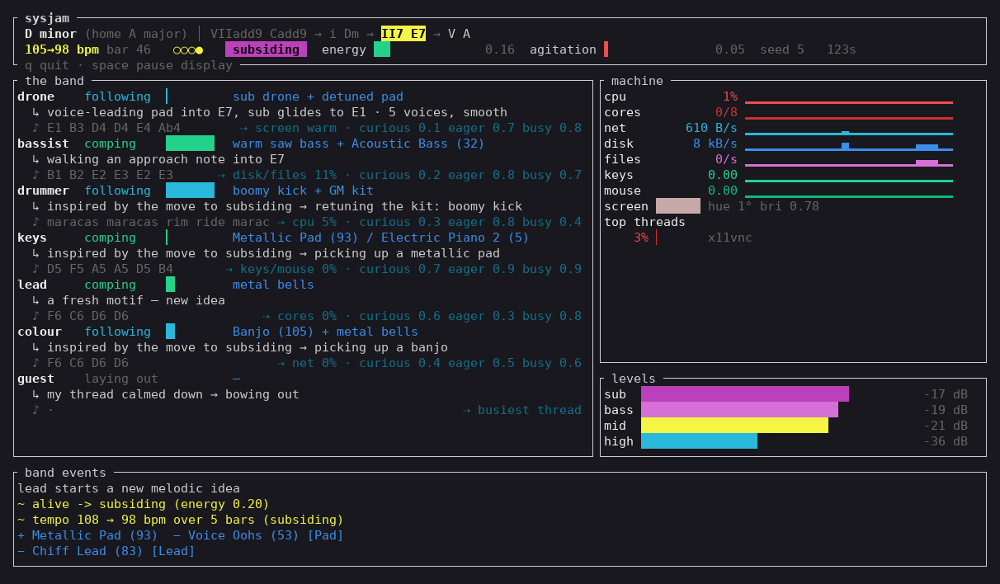

# sysjam

A jam band of machine musicians playing your Linux system. Six autonomous
players (drone, bassist, drummer, keys, lead, colour/FX) listen to CPU,
cores, network, disk writes, file activity and screen colour, and to each other.
A loose bandleader moves the arrangement through **chilling → awakening →
alive → subsiding**. Chords keep moving even on an idle machine. Every run
starts in a random key (any of the 12 roots, major or minor) at a random tempo
(60–100 bpm). The tempo then breathes with the arrangement and the key wanders
around the circle of fifths. Players pick up a new General MIDI instrument or
design a new synth patch whenever something inspires them. Under everything sits
a continuous deep sub drone and bass. No two runs are the same unless you pass `--seed`.

(Formerly developed under the working name *sysmusic*.) Listen: [`docs/sample.mp3`](docs/sample.mp3) is a 75 s demo at 192 kbps. It starts calm with no hiss, then hits chaos (CPU + network + disk load plus simulated fast typing), where a short burst of industrial noise comes in, then settles again. Its verbose log is `docs/sample-render.log`. [`docs/sample-tempo.mp3`](docs/sample-tempo.mp3) is a 90 s demo (seed 5, made with `tools/demo_tempo.sh`). It starts in A major at 84 bpm, and the tempo eases down to 71 while the band is chilling. Under load the band comes alive, ramps up to 95 bpm and modulates to D minor; when the load stops it subsides to 86 bpm. Its log is `docs/sample-tempo-render.log`.



One static-ish binary (`sysjam`, ~1.4 MB, x86_64, needs glibc ≥ 2.29). It
links only libc, libm, libpthread and libdl. ALSA, D-Bus and PipeWire are
loaded at run time with `dlopen`, so it starts even when one of them is missing.

## Run

```bash
./sysjam                         # play with the live terminal UI (q fades out; twice = quit now)
./sysjam --no-tui                # plain log output instead of the UI
./sysjam --no-tui --verbose      # plain log of everything: chords, players, instruments, metrics
./sysjam --volume 0.4 --sub 1.5  # quieter overall, more sub
./sysjam --seed 42               # reproducible run
./sysjam --wav out.wav --duration 120   # render to a file (real time)
```

| Option | Meaning |
|---|---|
| `--volume V` | master 0–1 (default 0.6) |
| `--sub L` | sub-drone level 0–2 (default 1.2). The sub is never high-passed; a gentle limiter guards the output |
| `--scale minor\|major`, `--root NOTE` | home key. Default: random each run (all 12 roots, major or minor, root in D#2–D3). Given flags are used exactly. Older scale names still work: dorian etc. map to minor, lydian etc. to major |
| `--bpm N` | lock the tempo at N. Default: a random start of 60–100 bpm, after which the bandleader moves it |
| `--chord-bars N` | base bars per chord (default 2). Chilling stretches this, peaks tighten it |
| `--seed N` | repeat a run exactly (same input → same music) |
| `--soundfont PATH`, `--no-gm`, `--gm-layers N` | General MIDI layer (see below); N = 1–4 simultaneous layers (default 3, +1 at peaks) |
| `--clicks L` | file open/close click texture 0–1 (default 0.25) |
| `--no-leads` | never let a busy thread sit in as a guest soloist |
| `--no-input` | don't watch keyboard/mouse activity (see below) |
| `--no-screen`, `--screen-method auto\|portal\|grim\|x11\|cmd`, `--screen-cmd CMD`, `--screen-interval S` | screen colour (see below) |
| `--device NAME` | ALSA device (`default`, `pipewire`, `pulse`, `hw:0`) |
| `--no-tui` | plain log lines instead of the live terminal UI (the UI is the default when stdout is a terminal) |
| `--null`, `--duration S`, `--verbose` | testing / logging (`--verbose` adds metrics lines with `--no-tui`) |

## Live terminal UI

When stdout is a terminal, sysjam opens a full-screen terminal UI (ratatui +
crossterm) that shows how the band is thinking. Piped or redirected output, or
`--no-tui`, gives the plain log instead.

- **Header**: key, the chord progression with roman numerals (past chords dim,
  the current chord highlighted, the planned ones after it), the home key when the
  band is away from it, e.g. `D minor (home A major)`, the tempo with an arrow while it is
  ramping (`105→98 bpm`; `(locked)` with `--bpm`), any half-time or double-time feel, bar and beat,
  the arrangement state (chilling / awakening / alive / subsiding) and the
  bandleader's energy and agitation meters.
- **The band**: one panel per member: drone, bassist, drummer, keys, lead,
  colour/FX, plus the guest voice when a busy thread sits in. Each panel shows:
  - the member's status: laying out, comping, following, soloing or trading;
  - an activity meter and the current GM instrument or synth patch;
  - a "thinking" line explaining the latest decision, e.g. `heard a network burst (98%) → adding shimmer`,
    `resolving the motif to the root (A4), then resting`,
    `kicks follow the bassist's syncopations`, or
    `thread make at 100% cpu sits in → long E5`, or why it picked up a new sound,
    e.g. `inspired by the modulation to D minor → picking up a fifths lead`;
  - the notes it played in the last few seconds, plus the machine signal it is tied
    to (`⇢ net 98%`) and its personality (`curious 0.4 eager 0.5 busy 0.6`).
- **Machine**: CPU, busy cores, network, disk writes, file churn, keyboard and
  mouse rates, each with a sparkline of the last two minutes. Below them sit a
  swatch of the sampled screen colour and the busiest threads.
- **Levels**: sub (< 60 Hz), bass, mid and high meters of the output.
- **Band events**: a rate-limited log of instrument changes, band moves,
  modulations and guests.

Keys:

| key | action |
|---|---|
| `q`, `Esc`, `Ctrl-C` | fade out and quit (press again to quit immediately) |
| `space` | pause / resume the display (the music keeps playing) |

The UI runs in its own thread at nice 5 and redraws at 5 fps. The audio thread
publishes a small snapshot about every 100 ms with a non-blocking `try_lock`, so
a slow or stalled terminal can never hold up the audio. The terminal is restored
on exit and also when sysjam panics. Colours follow `NO_COLOR`. The UI needs a
terminal of about 100×30 or larger; 130×36 is comfortable.

## The band

Each player has a personality, drawn from the seed: eagerness, busyness,
swing, how often it replies, and register. On every bar each player decides
whether to **lay out, comp, follow, solo or trade**. The decision depends on
the bandleader's invitation, the shared energy and what the others are doing.

| Player | Plays | Listens to |
|---|---|---|
| **Drone / landscape** | Continuous sub drone (detuned sine pair at 30–60 Hz plus 2nd/3rd harmonics, gliding to each chord root), and a voice-led detuned pad (low-mids). Never lays out. There is no constant hiss/air bed | energy, screen brightness |
| **Bassist** | Roots and fifths at 40–120 Hz, in three styles: long notes, pulsing roots, or a syncopated groove. Plays approach notes into the next chord. Heavy file/disk activity makes it busier | file + disk writes, the drummer |
| **Drummer** | Synth kick, plus the GM kit (channel 10) when a SoundFont is loaded. Locks onto the bassist's syncopations, adds fills and risers before section changes, crashes on entries | CPU, cores, the bassist |
| **Keys** | GM pads hold chord tones (common tones are kept between chords). Keys/plucks play arps, broken chords or offbeat comping, and take solos when invited | energy, the lead (trading) |
| **Lead / melody** | Sparse two-bar call phrases built from a motif it develops (repeat, sequence, invert, vary, fragment, new idea). Rests between phrases, and resolves the melody before laying out | agitation, colour player, keys |
| **Colour / FX** | Bells, shimmer clouds driven by network traffic, swells, odd GM colours (FX Atmosphere, Seashore, …). Answers the lead's phrases. **Industrial texture:** only when the band hears real chaos, i.e. agitation above 0.68 for 6 s, or alive with 3+ hot signals at once, or a rare deliberate colour move while alive. It is 1–3 bars of gated, rhythmic band-passed noise with a metallic resonance (peak ≈ 0.018, about −12 dB under the old continuous air bed and gated, so it averages far lower). It fades out as soon as things calm down, then waits 25 s before it can come back | network, the lead, chaos |
| *Guest* | A thread using >40% of a core for >10 s may sit in as a single quiet guest voice. It holds for ≥25 s, is released 10 s after it drops below 25%, then a 20 s cooldown applies. Compositor, audio-server and sysjam threads are ignored | that thread |

**Bandleader / arrangement.**
- **Energy** is a 15 s average of the system signals; **agitation** is a 3 s average.
- State changes only happen on phrase boundaries (4 bars). Each state must be held for 3–4 phrases (~36–48 s) before the next change; the thresholds have hysteresis:
  - chilling → awakening at energy > 0.22, or straight to alive on a big multi-signal spike;
  - awakening → alive at > 0.42;
  - alive → subsiding at < 0.30;
  - subsiding lasts 8–19 bars and peels players off: drums first, then the lead resolves, then the bass. It goes back to awakening if energy returns.
- Entries come with drum fills or noise risers.
- Surprises happen at most every 4 phrases: a solo (keys, lead or colour), a breakdown (drums and bass drop out), a bandleader key change, or a lone instrument in chilling.

**Harmony** is independent of the OS. Every 1–2 bars (`--chord-bars`) the
progression moves using 4- and 8-chord phrases drawn from weighted templates:
- major: I–V–vi–IV, vi–IV–I–V, ii–V–I, I–vi–IV–V, I–IV–vi–V, IV–I–V–vi, I–iii–IV–V, IV–V–iii–vi, and two 8-bar forms;
- minor: i–VI–III–VII, i–iv–v–i, i–VII–VI–VII, Andalusian i–VII–VI–V, i–iv–VII–III, i–III–VII–iv, VI–VII–i–i, i–VI–iv–V, and two 8-bar forms.

In chilling the band "meanders" through a Markov graph built from the same templates (every template step is a weighted edge).

About 13% of phrases take a **detour**:
- a secondary dominant (V/x), a borrowed chord (bVI, bVII, iv in major; IV or V in minor), or a colour phrase (sus2/sus4/add9/7ths);
- an occasional **modulation**: to the relative key via a pivot chord, to the parallel major or minor, or a fifth up or down around the circle of fifths via pivot → V7 → new tonic. Screen colour biases the new key's mode: warm/bright screens favour major, cool/dark favour minor.

**The home key isn't sacred.** Once a new key has lasted about 3 phrases, it can
become the new home (40% chance per phrase). The band then confirms it with a
V7 → I cadence and logs `~ new home key: D major (was A major)`. The pull back to
the old home is weak and builds only after about 6 phrases away. Over a long session
the key wanders.

**The tempo breathes.** At phrase boundaries the bandleader may set a new
target tempo, depending on the arrangement state and its agitation:

| state | tempo range |
|---|---|
| chilling | 58–76 bpm |
| awakening | 72–96 bpm |
| alive | 90–128 bpm |
| subsiding | drifts 4–14 bpm lower per move |

The tempo never jumps. It ramps smoothly over 2–8 bars (at most 24 bpm per ramp), one tiny step-length change per sixteenth, so the step clock stays glitch-free. The echo time follows the tempo, gliding one sample at a time. Sometimes the drummer plays a phrase or two in **half-time** or **double-time** feel. `--bpm N` locks the tempo; feel moves still happen.

The voicing keeps common tones and moves the other voices by the smallest
interval. The bass follows chord roots; shimmer, arps and the lead use chord
tones.

**System events push the band; they never drive notes directly.**
- CPU > 65% for 5 s → tension: the next chord becomes a V7, a secondary dominant or a borrowed chord (40 s cooldown).
- A net or disk burst (> 0.7 for 4 s) → modulation (90 s cooldown).
- Going back to idle after a busy stretch → a cadence resolving to the tonic (60 s cooldown).

`--verbose` shows all of this, rate-limited. For example:
```
Key: A minor | Am → E → Em7 → Asus2
~ sustained CPU spike -> tension
Key: A minor | E → Em7 → Asus2 → A7   (tension: A7 (V/Dm7))
~ chilling -> awakening (energy 0.48)
bassist joins
drummer joins
+ Warm Pad (89)  − Sweep Pad (95) [Pad]
Key: E major | A7 → Dm7 → B7 → E   (modulation: A minor -> E major)
keys takes a solo
```

## General MIDI instruments (SoundFont)

Instruments come from a GM `.sf2` file played by rustysynth (polyphony
capped at 28, reverb/chorus off). The file is found in this order:
1. `--soundfont PATH`
2. system paths: `/usr/share/sounds/sf2/FluidR3_GM.sf2`, `/usr/share/soundfonts/FluidR3_GM.sf2`, `default-GM.sf2`, `TimGM6mb.sf2`, `GeneralUser_GS.sf2`, any `/usr/share/soundfonts/*.sf2`
3. `~/.local/share/sysjam/*.sf2`
4. `TimGM6mb.sf2` (or any `.sf2`) next to the binary or in an `assets/` directory beside it or above it. **This file is shipped in this repo as `assets/TimGM6mb.sf2`**, so a source checkout finds it automatically.

If none is found, the band plays its oscillator instruments only and prints
one hint line: `sudo apt install fluid-soundfont-gm` (FluidR3, 140 MB, sounds
better than TimGM6mb).

Picks are weighted across all 128 programs plus the drum kit.
- 2–4 layers are active (pad, comp/keys, lead, colour, and sometimes a GM bass).
- There is no fixed rotation. A player picks up a new instrument when something **inspires** it:
  - a state change (e.g. awakening → alive);
  - a key change, or the band settling into a new home key;
  - its tied signal spiking (bassist: disk/files, drummer: CPU, keys: keyboard/mouse, lead: busy cores, colour: network);
  - hearing another player do something interesting: the lead's new idea, the colour player's answer, industrial noise, or a guest thread sitting in;
  - boredom, which grows with time on the same sound and comes faster for players with a high *curiosity* trait.
- Each sound stays at least 8–10 s, and a player isn't open to new inspiration for 15 s after a change.
- Swaps are crossfaded (CC11, 5–12 s) to the other channel of the player's pair. Held pad notes are re-struck on the new channel and released on the old one after its fade, so notes are never cut off. The reason shows in the TUI, e.g. `inspired by the move to subsiding → picking up a banjo`.
- Oscillator players design new **synth patches** the same way:
  - bassist: round sine / warm saw / growl / soft pluck, gliding over about 0.5 s;
  - drummer: deep / tight / boomy kick, latched per hit;
  - colour/lead bells: glass, octave chimes, metal, detuned soft, applied to new notes only.
- Program changes only happen on a channel that has been silent for 4 s.
- CC7 sets per-program gain, so odd programs (FX, helicopter, gunshot…) play quieter and rarer.
- Velocities are humanised.
- `--verbose` prints e.g. `+ Vibraphone (11)  − Sitar (104) [Comp]`.

**SoundFont licence (separate from the code).** `assets/TimGM6mb.sf2` is
© 2004 Tim Brechbill and © 2010 David Bolton. It is licensed under the **GNU GPL
version 2 only**. Debian's copyright file says "the terms of the GNU General
Public License version 2" and does not include an "or any later version"
clause. Provenance and the full GPL-2 text are in
`assets/TimGM6mb-LICENSE.txt`.

GPL-2-only is not compatible with GPL-3, so the SoundFont is **not** part of
the GPL-3.0-or-later program. It is a separately licensed data asset that is
distributed alongside the code, unmodified, as a "mere aggregation". sysjam
does not link or embed it; it only reads it as an input file at run time, just
like any other `.sf2` it finds. You can delete `assets/`, use `--soundfont`
with another file, or pass `--no-gm`. sysjam works fine without it.

## Sound / spectrum

The bands are filled deliberately:
- **sub** 20–60 Hz: drone and kick, mono, never high-passed;
- **bass** 60–250 Hz: bass voice and GM bass;
- **low-mids**: pad;
- **mids**: GM instruments, arps and lead;
- **highs**: bells, hats, cymbals and risers. The upper band stays quiet when calm; brief industrial noise only appears in chaos.

A gentle look-ahead-free limiter with a soft clip sits at the end of the chain.

Measured on the earlier 3-minute demo render (`tools/bands.py`, energy per band relative to the 800 Hz–3 kHz mids). That render still had the old air bed; in the new 75 s demo the 6–16 kHz band in the calm part is −34.9 dB (it was −27.6 dB), and sub/bass are +13.2/+7.2 dB calm and +8.5/−0.2 dB in chaos:

| band | idle 2–32 s | busy 50–110 s | winding down 140–178 s |
|---|---|---|---|
| sub 20–60 Hz | +14.1 dB | +6.3 dB | +10.1 dB |
| bass 60–250 Hz | +10.1 dB | +3.5 dB | +2.5 dB |
| low-mid 250–800 Hz | +9.7 dB | +3.4 dB | +2.8 dB |
| mid 800 Hz–3 kHz | 0 | 0 | 0 |
| high-mid 3–6 kHz | −13.9 dB | −13.9 dB | −16.3 dB |
| high 6–16 kHz | −27.6 dB | −25.4 dB | −25.6 dB |

Level is about −15 dBFS RMS with peaks around −2 to −5 dBFS. On small
speakers, raise `--sub` (up to 2) or lower `--volume`.

## Keyboard / mouse activity

Intense typing makes the band pick up, and mouse bursts nudge it more gently.
These are improvisational cues, not one click per keypress. sysjam only counts
**how many** input events happen; it never reads which keys.

Detection order (no root needed):
1. **`/proc/interrupts`**: deltas of the `i8042` lines (irq 1 = keyboard, irq 12 = PS/2 mouse/touchpad) and i2c-HID touchpad lines. Readable by everyone and essentially free. This covers most laptops' built-in keyboards and touchpads. USB keyboards don't get their own line (they share the USB controller's interrupt), so they are not counted this way.
2. **`/dev/input/event*`**, opened read-only and non-blocking, but only if your user can open them (the `input` group). Devices are classified by their sysfs name (keyboard / mouse / touchpad / trackpoint); everything else is skipped. sysjam counts key presses/repeats and motion events. Key codes are discarded unread and nothing is stored.
3. Otherwise it is off. `--verbose` prints one line saying why, and the music carries on.

Rates are smoothed over ~3 s and mapped to 0–1: about 6 keystrokes/s saturates the keyboard, and continuous mouse motion only reaches the mouse cap. The two together can add at most 0.45 to the bandleader's energy input, so they push but never dominate on their own. Heavy typing counts as a "hot" signal, and with high agitation it lets awakening → alive happen before the usual dwell. `--no-input` turns it off.

## Screen colour

Screen colour is a slow input. Warmth and brightness tint the pad, and they bias
whether a modulation lands in major or minor. Screen *changes* add a little energy.
It uses one heavily downsampled frame every `--screen-interval` seconds
(default 4).

`--screen-method auto` tries:
- **Wayland session** (COSMIC, GNOME): portal → grim → XWayland → off
- **X11 session**: X11 → portal → off

1. **xdg-desktop-portal ScreenCast** (D-Bus via `libdbus-1.so.3`, frames via
   `libpipewire-0.3.so.0`, both loaded at run time).
   - It asks for one monitor with `persist_mode=2`.
   - The restore token is saved to `~/.config/sysjam/portal-restore-token` (mode 0600, or under `$XDG_CONFIG_HOME`), so the share dialog appears **once**. Later runs restore silently. A stale token is deleted and the dialog is asked once more.
   - The PipeWire stream negotiates shared-memory RGB frames (no DMA-BUF). It is kept **paused** and resumed for a single frame every ~4 s; about 64×36 pixels are read.
   - If you press **Cancel**, sysjam remembers that in `~/.config/sysjam/portal-declined` and won't ask again. `--screen-method portal` asks again.
2. **grim** (wlroots / ext-image-copy compositors), if installed.
3. **X11 GetImage** (12 one-pixel rows). On Wayland it only sees XWayland
   windows; an all-black result is rejected. Connect and grab run on a helper thread with a 2 s limit, so a missing server fails fast and quietly.
4. `--screen-method cmd --screen-cmd "…"`: any command that prints a P6 PPM.

If nothing works you get one short line, such as
`screen colour: off (no portal/grim capture; --verbose for details)`, and
the music carries on. `--verbose` lists why each method was skipped.

All D-Bus calls use 5 s timeouts. The share dialog waits up to 90 s, and Ctrl-C
interrupts it. Capture runs on its own nice-15 thread, so it can never block audio.

## What you see on first run

```
instruments: /usr/share/sounds/sf2/FluidR3_GM.sf2      (or ./TimGM6mb.sf2)
audio: ALSA 'default' 44100 Hz stereo
sysjam playing: root F2 major, 87 bpm, seed 734912055  (Ctrl-C to fade out)
```
On a Wayland desktop the system **screen-share dialog** opens. Pick the monitor
and allow it. The music is already playing while the dialog is open. Then:
```
screen colour: xdg-desktop-portal ScreenCast, one tiny sample every 4s
```
The desktop may show its "screen is being shared" indicator while sysjam
runs. From the second run on there is no dialog.

## Performance

- Audio is rendered in 2048-frame blocks (~120 ms ALSA buffer). The oscillator bed updates at control rate; rustysynth renders in 64-sample blocks with polyphony capped at 28 and reverb/chorus off.
- Denormals are flushed to zero.
- The monitor thread runs at nice 10, the screen thread at nice 15. The PipeWire stream is paused between samples.

Measured exactly (schedstat, all threads) on an 8-vCPU Xeon VM:

| case | CPU (one core) | RSS |
|---|---|---|
| idle, FluidR3 GM (140 MB SoundFont) | 1.97% | 146 MB |
| idle, shipped TimGM6mb | 1.77% | 10 MB |
| idle, `--no-gm` | 1.47% | 3.7 MB |
| idle, TimGM6mb, input tracking on (/proc/interrupts) vs `--no-input` | 1.87% vs 1.63% (difference within run-to-run noise) | 10 MB |
| 75 s chaos demo (`tools/demo_short.sh`) | 2.15% | |
| 90 s tempo/key demo (`tools/demo_tempo.sh`: random key + tempo, 40 s of stress-ng/downloads/direct writes/typing), incl. WAV writing | 2.36% | |
| 3-min demo under heavy load (stress-ng, ~50 MB/s downloads, ~500 MB/s direct writes), incl. WAV writing | 2.50% | |
| offline engine only, alive state | ~1.7% | |
| idle, FluidR3, **live terminal UI on** vs `--no-tui` (same seed, side by side, 120 s, /proc utime+stime) | 2.22% vs 1.89% (the UI thread itself: 0.27%) | |
| alive under heavy load (busy thread as guest, ~400 MB/s writes, ~40 MB/s downloads, file churn), UI on, X11 screen sampling, 60 s | 3.05% | |

## Troubleshooting

**No sound / "cannot open ALSA device".** Pop!_OS routes ALSA `default` to
PipeWire through `pipewire-alsa`. Try `--device pipewire` or `--device pulse`,
and check `aplay -L`. You can always use `--wav test.wav --duration 30`.

**Instruments sound thin.** Install the better SoundFont with
`sudo apt install fluid-soundfont-gm`. It is found automatically, before the
shipped TimGM6mb.

**No share dialog / colour stays off on Wayland.**
- Run with `--verbose` to see why each method was skipped.
- The portal needs `xdg-desktop-portal` plus a backend with ScreenCast (`xdg-desktop-portal-cosmic` or `-gnome`) and PipeWire.
- If the compositor only offers DMA-BUF frames, sysjam says so and turns colour off.
- If you cancelled once, use `--screen-method portal` to be asked again. To forget the saved permission, delete `~/.config/sysjam/portal-restore-token`.

**The file-open clicks feel sparse.** `/proc/sys/fs/file-nr` is a cheap,
batched system-wide counter, so small bursts cancel out.

## Building

```bash
cargo build --release           # native build
# portable build used for dist/ (glibc 2.29 symbol baseline) via zig:
pip install ziglang && cargo install cargo-zigbuild --version 0.21.8
cargo zigbuild --release --target x86_64-unknown-linux-gnu.2.31
mkdir -p dist && cp target/x86_64-unknown-linux-gnu/release/sysjam dist/
```
Requires rustc ≥ 1.85 (rustysynth is pinned to 1.3.5).

Tools:
- `tools/demo_short.sh` renders the 75 s calm → chaos → calm demo. Typing is simulated through a fake `/proc/interrupts` (`SYSJAM_INTERRUPTS`).
- `tools/demo.sh` renders a 3-minute idle → spike → busy → idle demo.
- `tools/bands.py` prints band energies.
- `tools/measure.py SECS ./sysjam --null` measures sysjam's own CPU.
- `tools/portal_test.sh BIN COLOR ARGS…` runs the end-to-end portal test. It uses a private D-Bus, pipewire, wireplumber, a GStreamer test source and `tools/mock_portal.py`.
- `SYSJAM_BENCH=1 SYSJAM_BENCH_LOG=1 ./sysjam --seed 1` gives an offline 200 s timeline with CPU figures.

## Licence

sysjam is free software: you can redistribute it and/or modify it under the
terms of the GNU General Public License as published by the Free Software
Foundation, either version 3 of the License, or (at your option) any later
version (**GPL-3.0-or-later**). The full text is in `LICENSE`.

`assets/TimGM6mb.sf2` is a separately licensed asset (GPL-2.0-only); see above.
